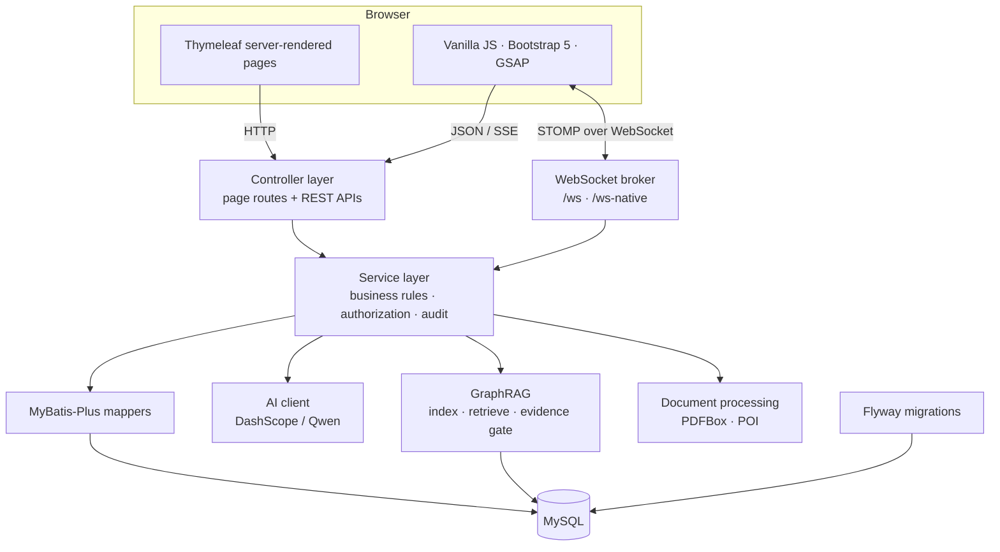
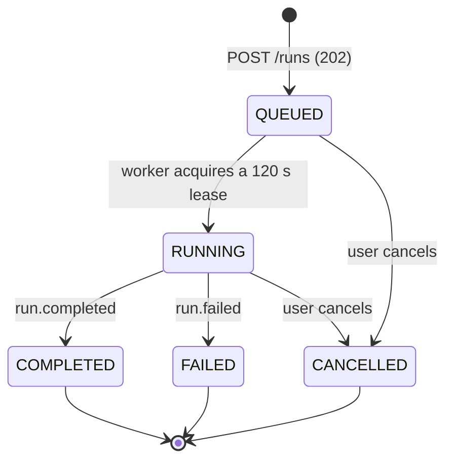

# iLink

> **Kindred minds find each other.**
> A competition teaming and collaboration platform for university students and teachers.

[](https://openjdk.org/)
[](https://spring.io/projects/spring-boot)
[](https://www.mysql.com/)
[](LICENSE)


**English** · [简体中文](README.zh-CN.md)


<p align="center">
  <a href="http://121.40.34.68:8090"><strong>Live Demo »</strong></a>
  &nbsp;·&nbsp;
  <a href="#quick-start">Run Locally</a>
  &nbsp;·&nbsp;
  <a href="#integration-standards">Integration Standards</a>
  &nbsp;·&nbsp;
  <a href="docs/superpowers/specs/">Design Docs</a>
</p>

---

## Contents

- [Project Overview](#project-overview) — background, core capabilities, innovation highlights
- [Architecture](#architecture) — technical architecture, modules, runtime flows
- [Integration Standards](#integration-standards) — API contracts, error codes, streaming, concurrency rules
- [Quick Start](#quick-start) · [Configuration](#configuration) · [API Surface](#api-surface)
- [Security](#security-and-data-handling) · [Database Migrations](#database-migrations) · [Deployment](#deployment)

## Project Overview

### Background

A university competition is rarely won or lost on the competition day. The friction is earlier and more mundane:

- **Event information is scattered.** Announcements live on official sites, in group chats and in forwarded documents; deadlines and eligibility rules are easy to miss.
- **Teams are assembled ad hoc.** Students post “looking for teammates” messages, then negotiate skills, schedules and roles in private chats. There is no structured place to describe a project need or to evaluate a candidate.
- **Collaboration fragments after the team forms.** Tasks move to one tool, documents to another, files to a chat group, and the final submission is reassembled by hand.
- **AI help is either absent or untrustworthy.** A generic chatbot does not know the team’s tasks, files or competition requirements, so its answers cannot be acted on.

iLink closes this loop in one workspace: **discover an event → find teammates → collaborate as a team → publish the outcome**.

### What iLink does

iLink is a server-rendered web application with two layers:

1. **A public portal** for the competition catalog, team marketplace, mentor wall, community and project showcase.
2. **A private team space** for member governance, tasks and milestones, real-time chat, collaboration assets (documents, spreadsheets, material matrix) and an AI Agent workbench.

Every team starts from a published team demand, becomes a collaboration unit when enough members are approved, and keeps its tasks, documents, files and decisions in one place until the outcome is published.

### Core capabilities

| Area | Capabilities |
| --- | --- |
| **Discover and team up** | Team marketplace with keyword/category/status filters; structured applications; team invitations; mentor wall with research directions and collaboration requests; administrator-maintained competition catalog; community channels; public profiles and project showcase |
| **Team lifecycle** | `OPEN` → `TEAMING` → `CLOSED`; approve, invite, remove, transfer ownership and dissolve; soft deletion preserves collaboration history |
| **Team space** | Access limited to the creator and approved members; task board with five states (`PENDING`, `IN_PROGRESS`, `REVIEW`, `COMPLETED`, `CANCELLED`); participants, comments and submissions; milestones with deadlines and overdue detection; statistics |
| **Real-time collaboration** | STOMP over WebSocket; persisted team chat history; per-user notifications and unread counts; redacted change broadcasts for collaboration assets |
| **Collaboration assets** | Markdown documents with autosave, 90-second edit leases, version snapshots/restore, ACL and trash; typed spreadsheets with CSV/XLSX export; material matrix linking requirements to evidence, with human review; asynchronous text extraction and team-scoped retrieval index |
| **Team Agent** | Persistent conversations; situation/risk analysis, weekly report drafts and task action proposals; human confirmation before any write; transactional action groups; audit trail; limited undo; SSE streaming with resumable cursors |
| **GraphRAG** | Evidence-gated retrieval with a fixed 2-hop quick mode and a ReAct deep-search mode; SSE streaming; conservative degradation when evidence is insufficient |
| **Accounts and governance** | `STUDENT` / `TEACHER` / `ADMIN`; registration limited to students and teachers; sign-in by phone, student/staff ID, username or email; BCrypt + session; audit log for administrative actions |

### Innovation highlights

1. **Human-in-the-loop Agent with transactional writes.** The Agent never mutates team data directly. It produces an `action.proposed` event and a reviewable action group; a user selects and confirms actions, the server re-validates permissions and versions, applies the whole group in one transaction, records an audit trail, and exposes a bounded undo path. A failed action fails the group instead of leaving half-applied state.
2. **Evidence-gated GraphRAG.** Required evidence is planned before answering, tool results are written to an evidence ledger, and the answer is checked against that ledger before it is emitted. When evidence is missing, the system says so and degrades to a conservative answer instead of presenting model guesses as platform facts. Retrieval degrades in defined steps: vector search → keyword search → fixed 2-hop graph walk.
3. **Collaboration primitives that survive concurrency.** Documents and spreadsheets use optimistic versions, hashed 90-second edit leases and atomic takeover, with conflict responses that tell the client who holds the lease and whether it should switch to read-only.
4. **One consistent contract across every surface.** Pages, JSON APIs, SSE and WebSocket messages all follow the same ownership, error and audit rules; container-level 404/500 errors are normalized into the same `Result<T>` envelope for JSON clients.
5. **Operationally boring by design.** A single Spring Boot process, Flyway as the only schema authority, content-hashed static assets, and explicit startup validation for production.

### Screenshots

**Public portal**

| Home | Team marketplace |
| --- | --- |
|  |  |
| **Mentor wall** | **Community** |
|  |  |
| **Competition catalog** | **Showcase** |
|  |  |

**Team workspace**

| Task board and team space | Agent workbench |
| --- | --- |
|  |  |
| **Members and smart matching** | **Admin console** |
|  |  |

## Architecture

### System context



iLink is a layered monolith with a deliberate split: **Thymeleaf renders the first paint on the server**, while a vanilla JavaScript layer handles interactivity, SSE streams and WebSocket subscriptions. Controllers own HTTP concerns, services own business rules and authorization, and MyBatis-Plus mappers own persistence. MySQL is the only stateful dependency; the schema is owned exclusively by Flyway.

### Module map

| Module | Responsibility | Implementation notes |
| --- | --- | --- |
| `controller` | Page routes, REST APIs, SSE endpoints | `PageController` serves only whitelisted page names; `GlobalExceptionHandler` normalizes errors; `ErrorContractController` normalizes container-level errors |
| `service` | Team, user, task, notification, upload and AI orchestration | Business authorization is checked here, not only in the HTTP layer |
| `service.ai` | Model calls, token accounting, web search | OpenAI-compatible DashScope client; separate chat and embedding models; keys are optional |
| `service.kg` | GraphRAG indexing, retrieval, evidence gating, tools | Chunking, embeddings, 2-hop walk, ReAct loop with hard budgets |
| `collab` | Documents, spreadsheets, material matrix, leases, ACL, trash | Versioned assets, hashed lease tokens, CSV/XLSX export, async index bridge |
| `teamagent` | Conversations, run queue, SSE events, action groups, undo | Durable event log per run; lease-based workers; strict request records |
| `security` | Sign-in, remember-me, WebSocket authorization | Session-fixed authentication, BCrypt, CSRF cookie token, per-subscription checks |
| `mapper` / `entity` | Persistence and data models | MyBatis-Plus, explicit table/column mapping |
| `config` | Security, MVC, WebSocket, cache, production checks | Startup validation refuses insecure production configuration |

### Runtime flows

**HTTP request lifecycle**

```text
Browser → Spring Security filter chain
        → CSRF / session / role checks
        → Controller (Result<T>)
        → Service (business authorization, transactions)
        → MyBatis-Plus mapper → MySQL
        → Result<T> JSON, or a Thymeleaf view for page routes
```

Page routes are resolved by `PageController` against a fixed `ALLOWED_PAGES` set; unknown names return the project’s own 404 page. Security rules are declared in `SecurityConfig`, so a new page or API must be added in both places when it needs to be publicly reachable.

**Team Agent run lifecycle**



Runs are queued with a bounded capacity (default 32) and executed by a fixed worker pool (default 4). Every state change is appended to a run-scoped event log with a monotonically increasing sequence number. The browser consumes that log over SSE using a `<runId>:<seq>` cursor, so a dropped connection resumes without replaying or losing events.

**Action proposal and confirmation**

```text
Agent run
  → action.proposed event (group version N)
  → user reviews and selects actions
  → POST /action-groups/{id}/confirm
      · re-check membership and permissions
      · re-check expected group version
      · apply all selected actions in one transaction
      · append audit records
  → EXECUTED (or FAILED with no partial writes)
  → optional bounded undo
```

**Evidence-gated answer pipeline**

```text
question
  → evidence plan (what must be proven)
  → retrieval: vector → keyword → fixed 2-hop graph walk
  → evidence ledger (tool results with provenance)
  → answer generation
  → evidence verification
  → answer + citations, or a conservative "insufficient evidence" response
```

The ReAct deep mode is bounded to 5 rounds, 8 tool calls and 45 seconds. Every bound is enforced server-side; the model cannot extend its own budget.

### Data model

| Concept | Storage | Notes |
| --- | --- | --- |
| Team | `team_demand` | The demand row *is* the team; lifecycle status lives on the same row |
| Membership | `team_application` with `status = APPROVED` | Applications and invitations share one table; `initiator_id = user_id` means self-application; `uk_team_user` requires upsert |
| Mentor profile | `teacher_application` | Created for teacher accounts and reviewed by administrators |
| Tasks / milestones | `task`, `project_milestone` | Five-state task board; milestone progress derives from linked tasks |
| Collaboration assets | `team_document`, `team_spreadsheet`, `material_*` | Versioned rows, ACL rows, lease rows and soft-delete/trash metadata |
| Agent state | `team_agent_conversation`, `team_agent_run`, `team_agent_run_event`, `team_agent_action_*` | Durable event log is the source of truth for streaming and recovery |
| Knowledge graph | `kg_*` tables | Chunks, entities, relations and fact provenance |
| Platform | `user`, `community_post`, `asset`, `competition`, `notification`, `audit_log` | Public portal data and governance |

### Deployment topology

```text
Client ──HTTPS──▶ Nginx / 1Panel ──▶ Spring Boot (single node, port 8090) ──▶ MySQL
                                          │
                                          ├── local upload directory (/uploads)
                                          └── DashScope API (optional)
```

The current target is a single application node. Static assets are content-hashed and cached for a year in production; uploaded files are served with a one-hour cache because they can be replaced. Horizontal scaling would require shared sessions and sticky WebSocket routing, which are not built in.

## Integration Standards

This section defines the contract for any client, module or service that integrates with iLink. The running code and Flyway migrations are authoritative; this section describes the invariants they enforce.

### 1. Transport and conventions

| Item | Standard |
| --- | --- |
| Protocol | HTTP/1.1 over the same origin; HTTPS in production |
| Body format | JSON (`application/json`), UTF-8 |
| Path style | Resource-oriented prefixes under `/api/**`; page routes are `/{page}.html` |
| Versioning | Path-based; additive changes are preferred, breaking changes require a new path |
| Time | Epoch milliseconds in `timestamp`; ISO-8601 strings for domain timestamps |
| Pagination | Page-based (`page`, `size`) or cursor/offset depending on the domain; metadata always in `extra.pagination` |
| Unknown request fields | Rejected for Agent request records (`@JsonIgnoreProperties(ignoreUnknown = false)`); treated as client bugs rather than silently ignored |

### 2. Response envelope

Every JSON endpoint returns the same wrapper:

```json
{
  "code": 200,
  "message": "OK",
  "data": {},
  "extra": {},
  "timestamp": 1760000000000
}
```

| Field | Meaning |
| --- | --- |
| `code` | Business/status code. `200` means success; for errors it mirrors the HTTP status |
| `message` | Human-readable message, safe to display |
| `data` | Payload; `null` for commands without a response body |
| `extra` | Machine-readable metadata: `pagination`, `errorCode`, `retryable`, `requestId`, conflict details |
| `timestamp` | Server time in epoch milliseconds |

Pagination metadata:

```json
{
  "extra": {
    "pagination": { "page": 1, "size": 20, "total": 137 }
  }
}
```

`Result.toHttpStatus()` maps `code` to the HTTP status, so clients may rely on either the status line or the envelope, but should read both.

### 3. Authentication and authorization

| Mechanism | Detail |
| --- | --- |
| Authentication | Spring Security form login; the authenticated user is stored in the HTTP session and exposed as `HttpSession` attribute `user` |
| Password storage | BCrypt |
| Session protection | Session fixation migration on login; remember-me tokens rotated and revoked on sign-out or password change |
| Roles | `STUDENT`, `TEACHER`, `ADMIN`; `/admin.html` and `/api/admin/**` require `ROLE_ADMIN` |
| Default rule | Every request requires authentication unless explicitly permitted |
| Public reads | `GET /api/community/posts*`, `GET /api/teacher/list`, `GET /api/teacher/{id}`, `GET /api/team/list`, `GET /api/team/{id}`, `GET /api/asset/list`, `GET /api/asset/{id}`, `GET /api/competitions`, `/api/user/public/**`, `/api/user/skills/public/**` |
| Public pages | Home, competitions, community and article pages, mentor wall, team marketplace, showcase, public profiles, detail pages and the team workspace shell |
| Unauthenticated API call | `401` with a JSON `Result` body; browser page requests are redirected to `/login.html?redirect=<encoded target>` |
| Insufficient role | `403` with a JSON `Result` body for API requests |

Business-level authorization is not delegated to URL patterns alone. Team membership, asset ACLs, team status and edit permissions are re-checked inside the service layer for every operation.

### 4. CSRF

| Item | Standard |
| --- | --- |
| Token storage | `XSRF-TOKEN` cookie (`HttpOnly = false`, readable by same-origin JavaScript) |
| Header | `X-XSRF-TOKEN` on every state-changing request (`POST`, `PUT`, `PATCH`, `DELETE`) |
| Exemptions | Only the WebSocket handshakes `/ws/**` and `/ws-native/**`; upload and file endpoints are **not** exempt |
| Client rule | All AJAX calls go through the shared `apiFetch` helper, which attaches credentials and the CSRF header automatically |

A missing or stale CSRF token fails before authentication and may surface as `403`; refresh the token from the cookie and retry once.

### 5. Error contract

`GlobalExceptionHandler` maps exceptions to stable HTTP statuses and messages:

| Condition | Status | `extra.errorCode` |
| --- | --- | --- |
| Validation failure (`@Valid`, `@Validated`) | 400 | — |
| Malformed or missing JSON body | 400 | — |
| Missing request parameter | 400 | — |
| Parameter type mismatch | 400 | — |
| Duplicate key / constraint violation | 400 | — |
| Upload too large | 400 | — |
| Unsupported media type | 415 | — |
| Unsupported HTTP method | 405 | — |
| Access denied | 403 | — |
| Team Agent domain error | Mapped from code | `TeamAgentErrorCode` name |
| Collaboration asset domain error | Mapped from code | `TeamCollabException.Code` name |
| Unhandled server error | 500 | — |

Agent errors add machine-readable details:

```json
{
  "code": 409,
  "message": "运行已在执行中",
  "extra": {
    "errorCode": "RUN_ALREADY_ACTIVE",
    "requestId": "…",
    "retryable": true
  }
}
```

When `retryable` is `false`, retrying the same request is pointless; when it is `true`, the client should back off and retry, honoring `Retry-After` if present.

**Agent error code families** (`TeamAgentErrorCode`):

- Authentication/authorization: `AUTH_REQUIRED`, `TEAM_ACCESS_DENIED`, `AGENT_ACTIONS_DISABLED`
- Request validity: `REQUEST_INVALID`, `SENSITIVE_INPUT_REJECTED`, `ACTION_SELECTION_INVALID`
- Missing state: `CONVERSATION_NOT_FOUND`, `RUN_NOT_FOUND`, `ACTION_GROUP_NOT_FOUND`, `ACTION_NOT_FOUND`
- Concurrency: `CONVERSATION_BUSY`, `RUN_ALREADY_ACTIVE`, `IDEMPOTENCY_KEY_REUSED`, `ACTION_DUPLICATE`, `ACTION_VERSION_CONFLICT`, `ACTION_PERMISSION_CHANGED`
- Lifecycle: `RUN_NOT_CANCELLABLE`, `ACTION_GROUP_EXPIRED`, `ACTION_ALREADY_FINALIZED`, `UNDO_NOT_AVAILABLE`, `UNDO_EXPIRED`, `UNDO_CONFLICT`, `UNDO_ALREADY_FINALIZED`
- Capacity and upstream: `AGENT_CAPACITY_EXCEEDED`, `AGENT_RATE_LIMITED`, `AGENT_BUDGET_EXCEEDED`, `AI_TIMEOUT`, `AI_RATE_LIMITED`, `AI_UPSTREAM_FAILED`, `AI_NOT_CONFIGURED`, `MODEL_OUTPUT_INVALID`
- Execution: `WORKER_LOST`, `ACTION_TRANSACTION_FAILED`, `ACTION_SCHEMA_UNSUPPORTED`

**Collaboration error codes** (`TeamCollabException.Code`): `TEAM_NOT_FOUND`, `TEAM_READ_ONLY`, `ASSET_NOT_FOUND`, `ASSET_FORBIDDEN`, `EDIT_LEASE_HELD`, `EDIT_LEASE_INVALID`, `EDIT_LEASE_EXPIRED`, `EDIT_VERSION_CONFLICT`, `REQUEST_ID_REUSED`, `CONTENT_TOO_LARGE`, `SPREADSHEET_SCHEMA_INVALID`, `EXPORT_FAILED`, `FILE_INDEX_FAILED`, `MATERIAL_EVIDENCE_INVALID`, `AGENT_ACTION_CONFLICT`, `REQUEST_INVALID`.

Collaboration errors are returned with `Cache-Control: no-store, must-revalidate` so a client or proxy never reuses a stale permission decision.

### 6. Concurrency, leasing and idempotency

| Mechanism | Contract |
| --- | --- |
| Optimistic version | Read an asset, send `baseVersion` with the write; a mismatch returns `409` with `EDIT_VERSION_CONFLICT` |
| Edit lease | `POST /collaboration/{assetType}/{assetId}/lease` acquires a **90-second** lease and returns a `leaseToken`; renew with `PUT`, release with `DELETE` |
| Lease conflict | `409 EDIT_LEASE_HELD` includes `extra.activeLease` and `extra.readOnly: true`; the client should switch to read-only instead of forcing a write |
| Lease security | Lease tokens are stored hashed and are never written to audit logs |
| Idempotency | State-changing commands accept a `clientRequestId`; replaying the same identifier returns a conflict (`REQUEST_ID_REUSED` / `IDEMPOTENCY_KEY_REUSED`) instead of applying the change twice |
| Action groups | Confirm with `expectedGroupVersion`; undo with `expectedActionVersion`; stale versions return `409` |
| Agent run lease | Worker lease defaults to 120 seconds; a lost worker is recovered and its run is failed or cancelled, never silently resumed twice |

Recommended client loop:

```text
acquire lease → edit with leaseToken + baseVersion
  → save → new version + renewed lease
  → on 409: refresh the asset, discard or merge local edits, re-acquire
  → release lease on blur/close
```

### 7. Server-Sent Events (SSE)

**Agent run stream**

```http
GET /api/team/{teamId}/agent/runs/{runId}/events
Accept: text/event-stream
Last-Event-ID: <runId>:<seq>
```

| Item | Standard |
| --- | --- |
| Cursor | `Last-Event-ID` in `<runId>:<seq>` form, or `?afterSeq=<seq>` |
| Event `id` | Same `<runId>:<seq>` cursor |
| Heartbeat | SSE comment every 15 seconds; comments carry no event id and are not persisted |
| Polling | Server polls the durable event log every 300 ms; clients do not need to poll |
| Ordering | Strictly increasing `seq` per run |
| Resume | Reconnect with the last received id; the server replays only later events |
| Terminal events | `run.completed`, `run.failed`, `run.cancelled` close the stream |
| Pre-stream failure | HTTP status plus `X-Team-Agent-Error-Code` (and `Retry-After` if applicable); the body is intentionally empty because `EventSource` expects a stream |
| Proxies | `Cache-Control: no-store`, `X-Accel-Buffering: no` |

Event types:

| Event | Meaning |
| --- | --- |
| `context.ready` | Team context and focused tasks have been assembled |
| `run.started` | Worker acquired the run |
| `tool.started` | A retrieval/tool call has begun |
| `message.delta` | Incremental answer text |
| `action.proposed` | An action group is ready for human review |
| `run.completed` | Run finished successfully (terminal) |
| `run.failed` | Run failed with a stable reason (terminal) |
| `run.cancelled` | Run was cancelled (terminal) |

**GraphRAG stream**: `POST /api/ai/graph-rag/agentic-query/stream` also returns `text/event-stream`, with the same no-buffering and no-store rules.

### 8. WebSocket / STOMP

| Item | Standard |
| --- | --- |
| Endpoints | `/ws` (SockJS) and `/ws-native` (native WebSocket) |
| Broker | Simple broker on `/topic` and `/queue`; application prefix `/app` |
| Team chat send | `/app/chat/{teamId}` |
| Team chat subscribe | `/topic/team/{teamId}` |
| Collaboration broadcast | Redacted `COLLABORATION_CHANGED` event only; no document content or lease tokens |
| Authorization | Authentication and team membership are verified on connect and on every subscription |
| CSRF | WebSocket handshakes are the only CSRF-exempt paths |

### 9. File upload

```http
POST /api/upload/attachment
Content-Type: multipart/form-data

file=<binary>&kind=proof
```

| Item | Standard |
| --- | --- |
| Part name | `file` |
| Optional parameter | `kind` (default `proof`) |
| Size limits | 50 MB per file, 100 MB per request; avatars, images, certificates, proofs and covers have smaller limits |
| Validation | Extension, declared size, file signature and normalized path |
| Serving | `/uploads/**` is public, but only files referenced by business records should be exposed |
| Cache | Uploaded files are served with `Cache-Control: public, max-age=3600` because they can be replaced |

### 10. Extending the system

| Change | Required steps |
| --- | --- |
| New page | Add the template, add the name to `PageController.ALLOWED_PAGES`, and add the route to `SecurityConfig` if it must be public |
| New REST API | Controller returning `Result<T>`, service-level authorization, mapper/entity if needed, and a Flyway migration for new tables/columns |
| New schema change | A new versioned migration in `src/main/resources/db/migration/`; never edit an applied migration |
| New error code | Add it to the relevant enum with an HTTP status and `retryable` flag; clients rely on the enum name |
| New Agent command | Add a strict request record, validate membership/version, write an audit record, and keep writes transactional |
| New front-end asset | Reference it with `th:href="@{/css/x.css}"`; the content-hash resolver adds the fingerprint automatically |
| New copy | Add keys to `messages.properties` and `messages_en.properties` |

### 11. Versioning and compatibility

- **Schema**: Flyway version numbers are append-only. `src/main/resources/db/migration/` is the single source of truth (currently 51 SQL migrations, V0_5–V51, plus Java migration V3).
- **API**: add fields and endpoints freely; do not change the meaning of an existing field or error code. Breaking changes require a new path.
- **Events**: SSE event names and `errorCode` values are machine contracts. Add new names rather than renaming existing ones.
- **Static assets**: content-hashed URLs are immutable; a new build produces new hashes, so no cache busting is needed.

## Quick Start

### Requirements

- JDK 17 or newer
- Maven 3.9 or newer
- MySQL 5.7 or MySQL 8

### 1. Create the database

```sql
CREATE DATABASE ilink
  DEFAULT CHARACTER SET utf8mb4
  COLLATE utf8mb4_unicode_ci;
```

Do not run `sql/schema.sql` first. Flyway applies `src/main/resources/db/migration/` on startup.

### 2. Configure the environment

The `dev` profile is active by default and listens on port `8090`. At minimum, provide the database password:

```powershell
$env:DB_HOST = "localhost"
$env:DB_PORT = "3306"
$env:DB_USERNAME = "root"
$env:DB_PASSWORD = "your_database_password"
$env:FILE_UPLOAD_DIR = "E:\data\ilink\uploads"
```

Keep AI and push credentials on your machine only:

```powershell
Copy-Item src/main/resources/application-local.yml.example src/main/resources/application-local.yml
```

`application-local.yml` is git-ignored. Never commit real credentials. AI features read `DASHSCOPE_API_KEY` / `EMBEDDING_API_KEY`.

### 3. Run

```bash
mvn spring-boot:run
```

Open [http://localhost:8090](http://localhost:8090).

### 4. Load demo data (optional)

`sql/demo_showcase_seed.sql` provides idempotent demo teams, mentors, posts and outcomes:

```bash
mysql -uroot -p --default-character-set=utf8mb4 ilink < sql/demo_showcase_seed.sql
```

The demo password is documented at the top of the script. Do not import demo data into production.

### 5. Test and package

```bash
mvn test
mvn clean package
java -jar target/iLink-1.0.jar
```

Tests use the `test` profile and an in-memory H2 database, so local MySQL is not required. `TeamCollaborationMysqlIT` is an optional real-MySQL integration test and is skipped by default.

## Configuration

Most settings can be supplied through environment variables:

| Variable | Purpose | Default / notes |
| --- | --- | --- |
| `SERVER_PORT` | HTTP port | `8090` |
| `SPRING_PROFILES_ACTIVE` | Spring profile | `dev` |
| `DB_HOST`, `DB_PORT`, `DB_USERNAME`, `DB_PASSWORD` | MySQL connection | `DB_PASSWORD` may also come from `SPRING_DATASOURCE_PASSWORD` |
| `FILE_UPLOAD_DIR` | Upload root | `./uploads` |
| `FILE_ACCESS_URL_PREFIX` | Upload URL prefix | `/uploads/` |
| `APP_PUBLIC_BASE_URL` | Public application URL | Used in password-reset and feedback links; must be HTTPS in production |
| `DASHSCOPE_API_KEY`, `DASHSCOPE_BASE_URL`, `DASHSCOPE_MODEL` | Chat / extraction model | OpenAI-compatible endpoint; AI is unavailable without a key |
| `EMBEDDING_API_KEY`, `EMBEDDING_BASE_URL`, `EMBEDDING_MODEL` | Graph vector retrieval | Falls back to keyword retrieval when unset |
| `AI_ENABLED`, `AI_SEARCH_ENABLED`, `AI_SEARCH_MAX_RESULTS` | AI and web search switches | Enabled by default; 5 search results |
| `TEAM_AGENT_ENABLED`, `TEAM_AGENT_ACTIONS_ENABLED`, `TEAM_AGENT_DEEP_GRAPH_RAG_ENABLED` | Team Agent capabilities | Enabled by default |
| `TEAM_AGENT_WORKER_CONCURRENCY`, `TEAM_AGENT_QUEUE_CAPACITY`, `TEAM_AGENT_LEASE_SECONDS` | Agent run queue | 4 / 32 / 120 seconds |
| `RESEND_API_KEY`, `APP_MAIL_FROM`, `SPRING_MAIL_HOST` | Email channel | Resend preferred; production still requires an SMTP host |
| `SERVERCHAN_SENDKEY`, `FEEDBACK_PUSH_ENABLED` | Feedback push | Feedback is still stored without push |
| `SESSION_COOKIE_SECURE` | Secure session cookie | Should be `true` in production |

Use the `prod` profile explicitly in production. On startup the application validates a non-root database account, a non-default database password, an HTTPS public URL, SMTP, a valid sender address, an absolute upload directory and a secure session cookie; it refuses to start if any check fails.

## API Surface

| Domain | Prefix | Notes |
| --- | --- | --- |
| Authentication | `/api/login`, `/api/register`, `/api/logout`, `/api/password-reset/**` | Sign-in, registration, sign-out, password recovery |
| Users and skills | `/api/user/**`, `/api/user/skills/**` | Profile, password, public profile, avatars, skills |
| Teams and members | `/api/team/**` | Publish, apply, approve, invite, manage, transfer, dissolve |
| Team collaboration | `/api/team-space/**`, `/api/tasks/**`, `/api/milestones/**` | Overview, tasks, submissions, comments, milestones |
| Collaboration assets | `/api/team/{teamId}/collaboration/**`, `/documents/**`, `/spreadsheets/**`, `/materials/**` | Documents, spreadsheets, material matrix, leases, ACL, trash |
| Team library | `/api/team/{teamId}/library/**` | Folders, files, previews, index status, trash |
| Team Agent | `/api/team/{teamId}/agent/**` | Conversations, runs, SSE events, action-group confirm/dismiss/undo |
| Chat and notifications | `/api/team/{teamId}/messages`, `/api/notifications/**` | History/send and notification center |
| Community and showcase | `/api/community/**`, `/api/asset/**` | Posts, interactions, comments, outcomes, downloads |
| Mentors, competitions, recommendations | `/api/teacher/**`, `/api/competitions`, `/api/recommendations/**` | Mentor profiles, catalog, matching |
| AI | `/api/team/{teamId}/ai/task-breakdown`, `/api/ai/competition-qa`, `/api/ai/graph-rag/**` | Task suggestions, competition Q&A, SSE Q&A, GraphRAG |
| Feedback and admin | `/api/feedback`, `/api/admin/**` | Site-wide feedback, administration and audit |

Common page routes:

```text
/index.html             Home
/team-market.html       Team marketplace
/teacher-wall.html      Mentor wall
/community.html         Community
/competitions.html      Competition catalog
/gallery.html           Showcase
/team-space.html        Team space (board, chat, members, assets, Agent)
/team-review.html       Task review workbench
/roster.html            Member roster
/user-profile.html      Public profile
/profile.html           Personal center
/admin.html             Admin console
```

Operational endpoints: `/actuator/health` is public; other Actuator endpoints are not exposed by default. SpringDoc OpenAPI 1.7.0 is on the classpath and produces `/v3/api-docs` and `/swagger-ui.html`; because those paths are not whitelisted, they inherit the default “authenticated” rule.

## Project Structure

```text
.
├── src/
│   ├── main/
│   │   ├── java/cn/ilink/
│   │   │   ├── config/       # Security, cache, MVC, WebSocket, production checks
│   │   │   ├── controller/   # Page routes and REST APIs
│   │   │   ├── service/      # Business rules, notifications, uploads
│   │   │   │   ├── ai/       # Model calls, usage, budgets, web search
│   │   │   │   └── kg/       # GraphRAG indexing, retrieval, evidence gating, tools
│   │   │   ├── collab/       # Team docs, sheets, material matrix, index bridge
│   │   │   ├── teamagent/    # Agent conversations, runs, SSE, action commands
│   │   │   ├── mapper/       # MyBatis-Plus data access
│   │   │   ├── entity/       # Persistence entities
│   │   │   ├── dto/, vo/     # Request and response models
│   │   │   ├── security/     # Sign-in, remember-me, WebSocket authorization
│   │   │   └── util/         # Password, HTML, IP and cache helpers
│   │   └── resources/
│   │       ├── db/migration/ # Flyway migrations (V0_5–V51 + Java V3)
│   │       ├── static/       # CSS, JavaScript, images and vendor assets
│   │       ├── templates/    # Thymeleaf pages and fragments
│   │       └── application*.yml
│   └── test/java/            # Unit, controller, security and route-contract tests
├── sql/                      # Historical/manual SQL and demo data
├── docs/                     # Design documents, evaluation reports, deployment notes
└── assets/readme/            # README screenshots and trailer
```

## Testing

```bash
mvn test
```

- Unit, controller, security and route-contract tests run on H2 and work out of the box.
- The real-MySQL integration test `TeamCollaborationMysqlIT` is skipped by default; enable it explicitly when needed.
- Add unit or web-layer tests for new behavior. Do not delete or skip tests just to make the build pass.

## Security and data handling

- Spring Security with BCrypt and session authentication, including session-fixation protection.
- State-changing requests use a cookie CSRF token (`X-XSRF-TOKEN`); only WebSocket handshakes are exempt.
- Remember-me tokens are persisted, rotated after use and revoked on sign-out or password change.
- Repeated failed sign-ins trigger a temporary lock. Password recovery does not reveal whether an account exists; tokens are stored hashed and are single-use.
- Community rich text is sanitized with a Jsoup whitelist. Uploads are validated by extension, size, file signature and normalized paths.
- General uploads are limited to 50 MB per file and 100 MB per request; avatars, images, certificates, proofs and covers have smaller limits.
- Administrative actions on users, roles, teams, mentors, outcomes, community and competitions are audited.
- Team documents, spreadsheets, materials and library files are checked against team status, asset scope and ACLs. Editing uses a 90-second lease and optimistic locking.
- Agent actions require user confirmation, run transactionally and are audited without storing content or lease tokens.
- Team material is extracted asynchronously; PDF/Office parsing has page, cell and size limits. Encrypted, corrupted or unsafe archives are marked as not indexed.
- Responses include CSP, `nosniff`, `X-Frame-Options`, `Referrer-Policy` and `Permissions-Policy` headers. CSP allows only `'self'`, `'unsafe-inline'` and `https://cdn.jsdelivr.net` for scripts.
- `app.api.expose-error-detail` is `false` by default, so internal messages and SQL details are not returned to clients.

## Database Migrations

`src/main/resources/db/migration/` is the single source of truth for the schema. It currently contains 51 SQL migrations (V0_5–V51) plus Java migration V3; the current schema version is V51.

`sql/` contains historical DDL, compatibility fixes and demo scripts. They are never executed automatically. Use them manually only after inspecting the target database’s `flyway_schema_history`, taking a backup and confirming the impact. See [sql/README.md](sql/README.md).

## Deployment

- Start with the `prod` profile and satisfy every startup validation listed above.
- Expose HTTPS through Nginx or a panel such as 1Panel; `APP_PUBLIC_BASE_URL` must be the public HTTPS URL.
- Use an absolute upload directory writable by the runtime account. Do not run the database as root.
- Static assets are content-hashed (`/css/x-<md5>.css`) and can be cached aggressively in production.
- A single node is enough to run iLink. Horizontal scaling requires shared sessions and sticky WebSocket routing.

Live demo: [http://121.40.34.68:8090](http://121.40.34.68:8090)

Project intro page (the “About the author” entry inside the app):
<https://su-yu-s.github.io/iLink-cn/>

## Known limitations

- Competition listings are maintained by administrators; official sites are not scraped.
- AI Q&A and GraphRAG require DashScope / Qwen credentials. Without them those features are unavailable; everything else keeps working.
- Team content indexing runs asynchronously, so large or complex Office files take longer to become searchable.
- The current deployment target is a single node; multi-tenancy and clustered sessions are not built in.
- SpringDoc is present but not curated as a public API reference; the integration contract in this README is the authoritative description.

## Contributing

Issues and pull requests are welcome.

1. Fork the repository and branch from `main`.
2. Keep changes focused and follow the existing layering, naming and styling conventions.
3. Deliver schema changes through Flyway migrations; do not rely on manual table edits.
4. Run `mvn test` before submitting. Include a screenshot or recording for UI changes.
5. Write concise Chinese commit messages. Never commit keys, database passwords, uploads or a local `application-local.yml`.

Design documents live in [`docs/superpowers/specs/`](docs/superpowers/specs/); the running code and migrations are authoritative.

## License

[Apache License 2.0](LICENSE)

## Acknowledgements

iLink stands on excellent open-source projects: Spring Boot, Spring Security, Thymeleaf, MyBatis-Plus, Flyway, Caffeine, Jsoup, Apache PDFBox, Apache POI, GSAP and Bootstrap. AI capabilities are powered by Qwen models through Alibaba Cloud DashScope.

---

<p align="center">
  <sub>For every team, find the people on your frequency.</sub>
</p>
