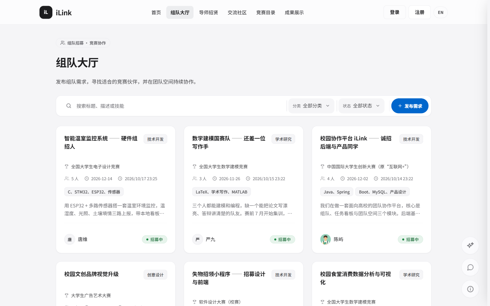
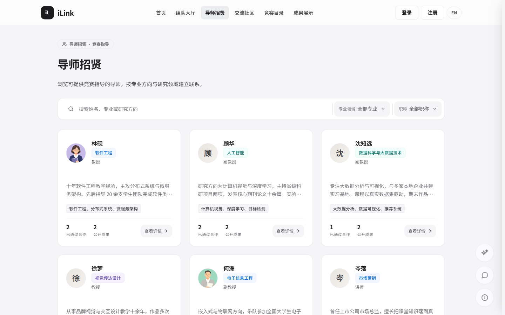
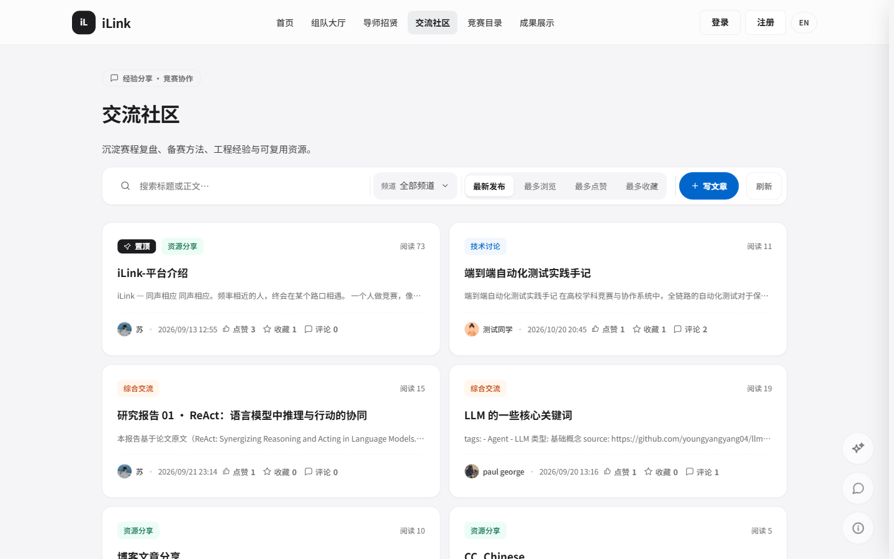
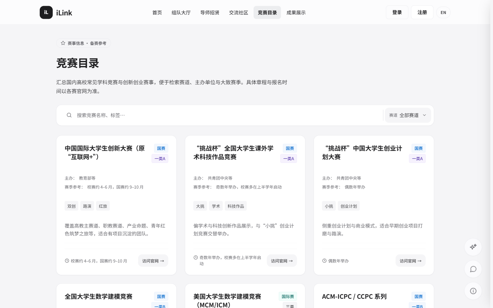
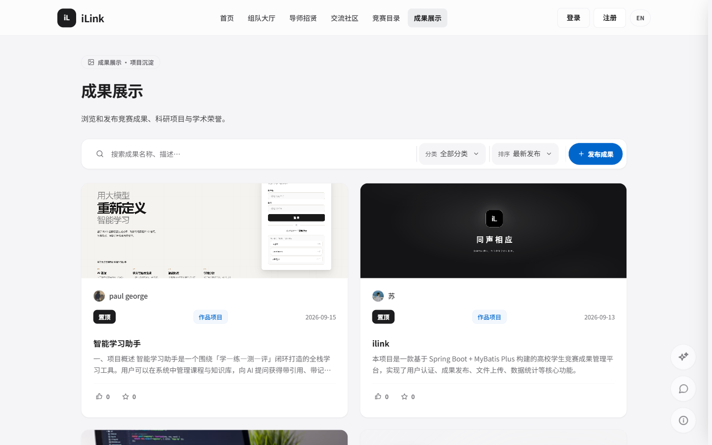
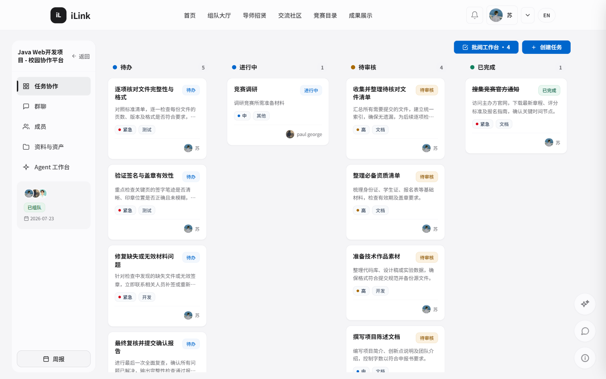
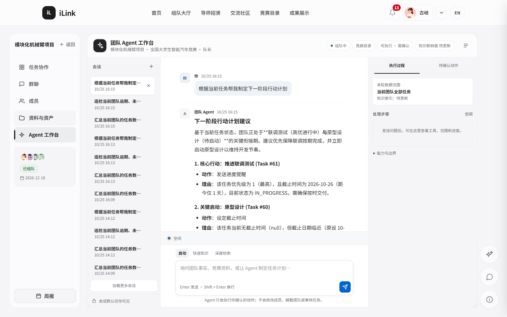
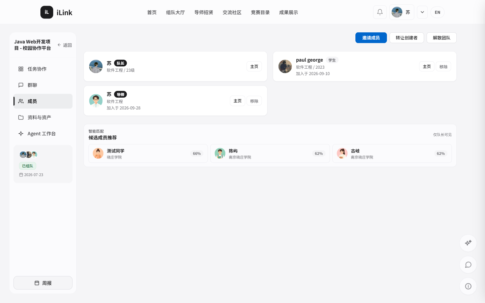
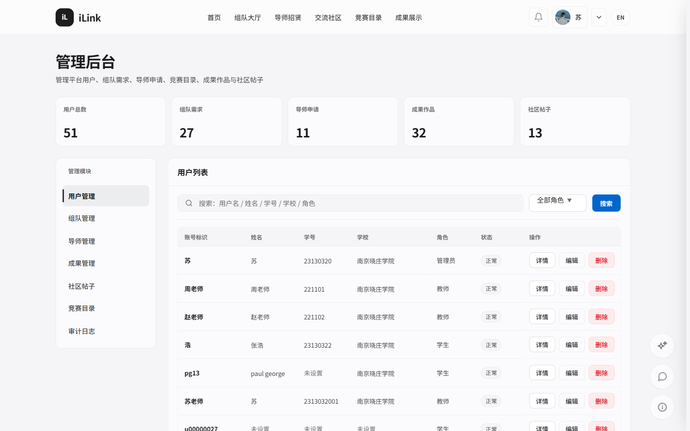
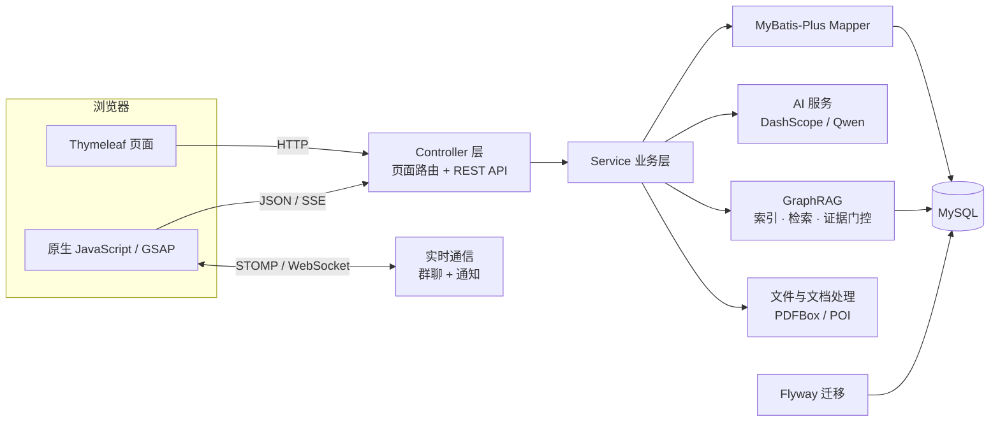

# iLink

> **同声相应，同气相求。**
> 面向高校师生的竞赛组队与团队协作平台。

[](https://openjdk.org/)
[](https://spring.io/projects/spring-boot)
[](https://www.mysql.com/)
[](LICENSE)


**简体中文** · [English](README_EN.md)


<p align="center">
  <a href="http://121.40.34.68:8090"><strong>在线体验 »</strong></a>
  &nbsp;·&nbsp;
  <a href="#快速开始">本地运行</a>
  &nbsp;·&nbsp;
  <a href="docs/superpowers/specs/">设计文档</a>
</p>

---

## 为什么是 iLink

高校竞赛的难点往往不在比赛本身：赛事信息散落在各个官网，队友靠群聊和问卷拼凑，组队后任务、文档、聊天记录又散落在不同工具里。iLink 把「发现赛事 → 找到队友 → 团队协作 → 沉淀成果」串成一条完整链路，让一个团队从第一次打招呼到最终答辩，都留在同一个空间里。

平台不是赛事信息的搬运工：赛事目录、日期和链接由管理员维护，不自动抓取官网；AI 只使用你授权范围内的团队资料与公开赛事信息。

## 功能一览

### 发现与组队

- **组队大厅**：按关键词、类别和状态浏览队伍，学生申请加入，队长审核后完成组队。
- **导师招贤**：浏览已审核的教师档案，按专业方向建立联系并提交合作申请。
- **竞赛目录**：分页检索赛事信息，管理员在后台维护目录与关键时间节点。
- **交流社区**：综合、技术、竞赛、资源四个频道，支持文章发布、评论、点赞、收藏与个人文章管理。
- **成果展示**：公开浏览项目成果，登录用户可发布、维护、下载自己的作品。
- **公开个人主页**：展示可公开的简介、技能、荣誉、文章与成果。

### 团队全流程协作

- **队伍生命周期**：`OPEN`（招募中）→ `TEAMING`（已组队）→ `CLOSED`（已结束），人数达标后自动进入协作状态。
- **成员治理**：邀请、审批、移除、转让创建者、解散团队（软删除并保留协作历史）。
- **团队空间**：只有创建者与已批准成员可以访问团队资料、成员、任务与统计。
- **任务看板**：`PENDING` / `IN_PROGRESS` / `REVIEW` / `COMPLETED` / `CANCELLED` 五态流转，覆盖创建、指派、评论、提交与审核闭环。
- **里程碑**：记录截止时间、交付物与完成率，自动呈现待开始、进行中、已完成或已延期。
- **实时沟通**：团队群聊走 STOMP/WebSocket，历史消息与通知持久化，支持未读计数与用户级推送。

### 协作资产

- **团队文档**：Markdown 文档支持自动保存、编辑租约、版本快照、恢复、导出与回收站，可见范围支持全团队或按 ACL 授权。
- **团队表格**：结构化表格支持列类型、行列编辑、版本恢复、CSV/XLSX 导出与回收站。
- **材料矩阵**：把竞赛材料要求与文件、文档、表格、任务证据关联；系统建议只到「待复核」，最终状态由真人确认。
- **资料正文索引**：PDF、Office、Markdown、文本与表格正文异步抽取，进入团队作用域的检索索引；删除或失去权限后立即停止检索。

### Agent 工作台与 GraphRAG

- **团队 Agent**：按会话持久化团队知识问答、态势与风险分析、周报草稿和任务/协作动作提案。
- **人工确认**：Agent 的动作必须由用户确认后才写入，整组事务执行，可审计、可有限撤销。
- **两种问答模式**：固定 2 跳的快速答疑，以及 ReAct 多轮探索的深度搜索（最多 5 轮、8 次工具调用、45 秒），支持 SSE 流式返回。
- **证据门控**：先规划所需证据，工具结果写入证据账本，答案经校验后才输出；证据不足时保守降级，不把无原文依据的内容写成平台事实。
- **可降级设计**：Embedding 未配置时回落关键词检索；ReAct 失败时回落固定 2 跳；图谱无召回时由模型知识兜底。

### 账号与治理

| 角色 | 主要权限 |
| --- | --- |
| `STUDENT` | 注册、完善资料、找队伍/导师、参与团队协作、发布社区内容与成果 |
| `TEACHER` | 维护导师档案、处理学生合作申请、参与团队协作 |
| `ADMIN` | 管理用户、角色、队伍、导师、成果、社区与竞赛目录，并写入审计日志 |

公开注册只允许学生与教师身份，管理员由平台授予。登录支持手机号、学号/工号、用户名或邮箱；密码为 8–32 位，需同时包含大写字母、小写字母和数字。

## 界面预览

### 公开门户

| 首页 | 组队大厅 |
| --- | --- |
|  |  |
| **导师招贤** | **交流社区** |
|  |  |
| **竞赛目录** | **成果展示** |
|  |  |

### 团队空间

| 任务看板 | Agent 工作台 |
| --- | --- |
|  |  |
| **成员与智能匹配** | **管理后台** |
|  |  |

## 系统架构



应用是经典的单体分层结构：Controller 处理页面与 HTTP 接口，Service 承担业务规则，Mapper 通过 MyBatis-Plus 访问 MySQL；Thymeleaf 在服务端渲染页面，静态资源由浏览器加载。数据库结构只通过 Flyway 迁移演进，`src/main/resources/db/migration/` 是唯一事实来源。

| 模块 | 说明 |
| --- | --- |
| `controller` | 页面路由、REST 接口、SSE 流式响应 |
| `service` | 业务规则、通知、上传、AI 调用与用量审计 |
| `service/kg` | GraphRAG 索引、检索、Agent 工具与证据门控 |
| `collab` | 团队文档、表格、材料矩阵、编辑租约与索引桥接 |
| `teamagent` | Agent 会话、运行队列、SSE 事件、动作提案与命令层 |
| `security` | 登录、记住我、WebSocket 鉴权与会话防护 |
| `mapper` / `entity` | 数据访问与持久化模型 |
| `config` | 安全、缓存、MVC、WebSocket 与生产环境校验 |

## 技术栈

| 层级 | 采用技术 |
| --- | --- |
| 后端 | Java 17、Spring Boot 2.7.18、Spring MVC、Spring Security |
| 数据访问 | MySQL、MyBatis-Plus 3.5.5、Flyway 7.11 |
| 页面与交互 | Thymeleaf、HTML5、CSS3、原生 JavaScript、Bootstrap 5、GSAP 3 |
| 实时能力 | Spring WebSocket、STOMP、SockJS |
| 缓存与内容 | Caffeine、Jsoup |
| AI 与图谱 | DashScope OpenAI 兼容接口、Qwen 聊天/Embedding、JTokkit |
| 文档处理 | Apache PDFBox、Apache POI |
| 接口与运维 | SpringDoc OpenAPI、Spring Boot Actuator |
| 测试 | JUnit 5、Mockito、Spring Security Test、H2 |

## 快速开始

### 环境要求

- JDK 17 或更高版本
- Maven 3.9 或更高版本
- MySQL 5.7 或 MySQL 8

### 1. 创建数据库

```sql
CREATE DATABASE ilink
  DEFAULT CHARACTER SET utf8mb4
  COLLATE utf8mb4_unicode_ci;
```

不要先执行 `sql/schema.sql`。应用启动后会由 Flyway 自动执行 `src/main/resources/db/migration/` 中的迁移。

### 2. 配置环境变量

开发环境默认启用 `dev` profile，端口为 `8090`。至少需要提供数据库密码：

```powershell
$env:DB_HOST = "localhost"
$env:DB_PORT = "3306"
$env:DB_USERNAME = "root"
$env:DB_PASSWORD = "your_database_password"
$env:FILE_UPLOAD_DIR = "E:\data\ilink\uploads"
```

也可以复制本地私有配置模板，把 AI 与反馈推送的密钥只放在本机：

```powershell
Copy-Item src/main/resources/application-local.yml.example src/main/resources/application-local.yml
```

`application-local.yml` 已被 Git 忽略，请勿提交真实密钥。AI 配置使用 `DASHSCOPE_API_KEY` / `EMBEDDING_API_KEY`。

### 3. 启动

```bash
mvn spring-boot:run
```

启动完成后访问 [http://localhost:8090](http://localhost:8090)。

### 4. 导入演示数据（可选）

`sql/demo_showcase_seed.sql` 提供可重复执行的组队、导师、社区与成果演示数据，方便在本地看到完整页面效果：

```bash
mysql -uroot -p --default-character-set=utf8mb4 ilink < sql/demo_showcase_seed.sql
```

演示账号统一密码见脚本头部注释。正式环境请勿导入演示数据。

### 5. 测试与打包

```bash
mvn test
mvn clean package
java -jar target/iLink-1.0.jar
```

测试自动使用 `test` profile 与 H2 内存数据库，不依赖本地 MySQL。`TeamCollaborationMysqlIT` 是可选的 MySQL 集成测试，默认不执行。

## 配置说明

常用配置均可通过环境变量注入：

| 变量 | 用途 | 默认 / 说明 |
| --- | --- | --- |
| `SERVER_PORT` | HTTP 端口 | `8090` |
| `SPRING_PROFILES_ACTIVE` | Spring Profile | `dev` |
| `DB_HOST`、`DB_PORT`、`DB_USERNAME`、`DB_PASSWORD` | MySQL 连接 | 开发时 `DB_PASSWORD` 也可由 `SPRING_DATASOURCE_PASSWORD` 覆盖 |
| `FILE_UPLOAD_DIR` | 上传文件根目录 | 默认 `./uploads` |
| `FILE_ACCESS_URL_PREFIX` | 上传文件 URL 前缀 | 默认 `/uploads/` |
| `APP_PUBLIC_BASE_URL` | 应用对外地址 | 密码重置与反馈详情链接使用；生产必须是 HTTPS |
| `DASHSCOPE_API_KEY`、`DASHSCOPE_BASE_URL`、`DASHSCOPE_MODEL` | 聊天 / 抽取模型 | OpenAI 兼容接口；未配置密钥时 AI 不可用 |
| `EMBEDDING_API_KEY`、`EMBEDDING_BASE_URL`、`EMBEDDING_MODEL` | 图谱向量检索 | 未配置时自动回落关键词检索 |
| `AI_ENABLED`、`AI_SEARCH_ENABLED`、`AI_SEARCH_MAX_RESULTS` | AI 与联网搜索开关 | 默认开启，搜索结果默认 5 条 |
| `TEAM_AGENT_ENABLED`、`TEAM_AGENT_ACTIONS_ENABLED`、`TEAM_AGENT_DEEP_GRAPH_RAG_ENABLED` | Team Agent 能力开关 | 默认开启 |
| `TEAM_AGENT_WORKER_CONCURRENCY`、`TEAM_AGENT_QUEUE_CAPACITY`、`TEAM_AGENT_LEASE_SECONDS` | Agent 运行队列 | 默认 4 / 32 / 120 秒 |
| `RESEND_API_KEY`、`APP_MAIL_FROM`、`SPRING_MAIL_HOST` | 邮件通道 | Resend 优先；生产校验仍要求 SMTP host |
| `SERVERCHAN_SENDKEY`、`FEEDBACK_PUSH_ENABLED` | 反馈推送 | 不配置时反馈仍会保存，只是不推送 |
| `SESSION_COOKIE_SECURE` | 会话 Cookie 的 Secure 属性 | 生产应为 `true` |

生产环境请显式使用 `prod` profile。应用启动时会校验：非 root 数据库账号、非默认数据库密码、HTTPS 公开地址、SMTP、合法发件地址、绝对上传目录与 Secure 会话 Cookie；任一项缺失会拒绝启动。

## 接口与页面

所有 JSON 接口使用 `Result<T>` 统一包装，分页元数据位于 `extra.pagination`：

```json
{
  "code": 200,
  "message": "获取成功",
  "data": {},
  "extra": {},
  "timestamp": 0
}
```

| 接口域 | 路径前缀 | 说明 |
| --- | --- | --- |
| 认证 | `/api/login`、`/api/register`、`/api/logout`、`/api/password-reset/**` | 登录、注册、退出与密码找回 |
| 用户与技能 | `/api/user/**`、`/api/user/skills/**` | 资料、密码、公开主页、内置头像与技能 |
| 组队与成员 | `/api/team/**` | 发布、申请、审批、邀请、成员管理、转让与解散 |
| 团队协作 | `/api/team-space/**`、`/api/tasks/**`、`/api/milestones/**` | 概览、任务、提交、评论与里程碑 |
| 协作资产 | `/api/team/{teamId}/collaboration/**`、`/documents/**`、`/spreadsheets/**`、`/materials/**` | 文档、表格、材料矩阵、编辑租约、ACL 与回收站 |
| 团队资料库 | `/api/team/{teamId}/library/**` | 文件夹、文件、预览引用、索引状态与回收站 |
| Team Agent | `/api/team/{teamId}/agent/**` | 会话、运行、SSE 事件、动作组确认/忽略/撤销 |
| 聊天与通知 | `/api/team/{teamId}/messages`、`/api/notifications/**` | 聊天历史/发送与通知中心 |
| 社区与成果 | `/api/community/**`、`/api/asset/**` | 文章、互动、评论、成果与下载 |
| 导师、竞赛、推荐 | `/api/teacher/**`、`/api/competitions`、`/api/recommendations/**` | 导师、赛事目录与匹配推荐 |
| AI | `/api/team/{teamId}/ai/task-breakdown`、`/api/ai/competition-qa`、`/api/ai/graph-rag/**` | 任务建议、竞赛答疑、SSE 流式答疑与 GraphRAG |
| 反馈与管理 | `/api/feedback`、`/api/admin/**` | 全站反馈、后台治理与审计 |

典型页面入口：

```text
/index.html             首页
/team-market.html       组队大厅
/teacher-wall.html      导师招贤
/community.html         交流社区
/competitions.html      竞赛目录
/gallery.html           成果展示
/team-space.html        团队空间（看板、群聊、成员、资料、Agent）
/team-review.html       任务批阅工作台
/roster.html            成员名册
/user-profile.html      公开个人主页
/profile.html           个人中心
/admin.html             管理后台
```

WebSocket 端点为 `/ws`（SockJS）与 `/ws-native`；团队聊天发送到 `/app/chat/{teamId}`，订阅 `/topic/team/{teamId}`。协作资产变更只广播脱敏的 `COLLABORATION_CHANGED` 事件。入站连接与订阅会检查登录状态与团队成员资格。

## 项目结构

```text
.
├── src/
│   ├── main/
│   │   ├── java/cn/ilink/
│   │   │   ├── config/       # 安全、缓存、MVC、WebSocket、生产校验
│   │   │   ├── controller/   # 页面路由与 REST 接口
│   │   │   ├── service/      # 业务规则、通知、上传
│   │   │   │   ├── ai/       # 模型调用、用量、预算与联网搜索
│   │   │   │   └── kg/       # GraphRAG 索引、检索、证据门控与工具
│   │   │   ├── collab/       # 团队文档、表格、材料矩阵与索引桥接
│   │   │   ├── teamagent/    # Agent 会话、运行、SSE 与动作命令层
│   │   │   ├── mapper/       # MyBatis-Plus 数据访问
│   │   │   ├── entity/       # 持久化实体
│   │   │   ├── dto/、vo/     # 请求与响应模型
│   │   │   ├── security/     # 登录、记住我与 WebSocket 鉴权
│   │   │   └── util/         # 密码、HTML、IP、缓存等工具
│   │   └── resources/
│   │       ├── db/migration/ # Flyway 版本化迁移（V0_5–V51 + Java V3）
│   │       ├── static/       # CSS、JavaScript、图片与前端库
│   │       ├── templates/    # Thymeleaf 页面与 fragments
│   │       └── application*.yml
│   └── test/java/            # 单元、控制器、安全与路径契约测试
├── sql/                      # 历史/人工 SQL 与演示数据，非自动迁移来源
├── docs/                     # 设计文档、评测报告与部署手册
└── assets/readme/            # README 截图与演示素材
```

## 测试

```bash
mvn test
```

- 单元、控制器、安全与路径契约测试使用 H2 内存数据库，开箱即跑。
- 真实 MySQL 集成测试 `TeamCollaborationMysqlIT` 默认跳过，需要时通过 Maven Profile 或环境变量显式启用。
- 新增功能请至少补充对应的单元或 Web 层测试；不要为了通过测试而删除或跳过用例。

## 安全与数据处理

- Spring Security + BCrypt + Session 认证，登录时会话固定攻击防护。
- 变更类 AJAX 请求使用 Cookie CSRF Token（`X-XSRF-TOKEN`），前端公共脚本自动携带同源凭证与请求头。
- 「记住我」令牌持久化并在使用后轮换，退出或改密后撤销。
- 连续登录失败达到阈值后临时锁定；密码找回不泄露账号是否存在，令牌只保存哈希且一次性有效。
- 社区富文本经 Jsoup 白名单净化；上传使用扩展名、大小、文件签名与路径规范化校验。
- 常规上传单文件最大 50 MB、单请求最大 100 MB；头像、图片、证书、证明与封面另有更小限制。
- 管理员的用户、角色、队伍、导师、成果、社区与竞赛维护操作写入审计日志。
- 团队文档、表格、材料与资料库文件按团队状态、资产范围与 ACL 校验；编辑使用 90 秒租约与乐观锁。
- Agent 动作必须由用户确认后写入，整组事务执行，审计不保存正文与租约令牌。
- 团队资料正文异步抽取，PDF/Office 有页数、单元格与大小上限；加密、损坏、压缩包等无法安全解析的文件标记为不索引。
- 响应头包含 CSP、`nosniff`、`Referrer-Policy` 与 `Permissions-Policy` 等基础防护。

## 数据库迁移

`src/main/resources/db/migration/` 是当前数据库结构的唯一事实来源，当前包含 51 个 SQL 迁移（V0_5–V51）与 Java 迁移 V3，最新结构版本为 V51。

`sql/` 保存历史建表、兼容修复与演示数据脚本，不会被启动过程自动执行。只有在明确了解目标库的 `flyway_schema_history`、完成备份并确认影响范围后，才应人工使用其中脚本；详情见 [sql/README.md](sql/README.md)。

## 部署

- 使用 `prod` profile 启动，并按上面的校验项准备环境变量。
- 通过 Nginx 或 1Panel 等反向代理暴露 HTTPS；`APP_PUBLIC_BASE_URL` 必须指向公网 HTTPS 地址。
- 上传目录使用绝对路径并确保运行账号可写；数据库账号不要使用 root。
- 静态资源已按内容指纹自动版本化（`/css/x-<md5>.css`），生产环境可长期缓存。
- 单机部署即可运行；如需水平扩展，请先处理会话共享与 WebSocket 粘性。

在线演示：[http://121.40.34.68:8090](http://121.40.34.68:8090)

项目介绍页（应用内「关于作者」入口）：
<https://su-yu-s.github.io/iLink-cn/>

## 已知限制

- 赛事目录由管理员维护，不自动抓取赛事官网。
- AI 问答与 GraphRAG 需要 DashScope / Qwen 密钥；未配置时相关能力不可用，但其余功能正常运行。
- 团队资料索引依赖异步任务；大文件或复杂 Office 文档的解析时间会更长。
- 当前以单机部署为主，尚未内置多租户与集群会话方案。

## 参与贡献

欢迎提交 Issue 与 Pull Request。

1. Fork 仓库并从 `main` 创建分支。
2. 保持改动聚焦，遵循项目现有的分层、命名与样式约定。
3. 新增数据库结构必须通过 Flyway 迁移交付，不依赖手工改表。
4. 提交前运行 `mvn test`；涉及页面时请附上截图或录屏。
5. Commit message 使用中文简明描述改动；不要提交密钥、数据库密码、上传文件或本地 `application-local.yml`。

设计文档位于 [`docs/superpowers/specs/`](docs/superpowers/specs/)，实现细节以运行代码与迁移为准。

## 许可证

[Apache License 2.0](LICENSE)

## 致谢

iLink 建立在众多优秀开源项目之上：Spring Boot、Spring Security、Thymeleaf、MyBatis-Plus、Flyway、Caffeine、Jsoup、Apache PDFBox、Apache POI、GSAP 与 Bootstrap。AI 能力由阿里云百炼 DashScope 的 Qwen 模型提供。

---

<p align="center">
  <sub>为每一次组队，找到频率相近的人。</sub>
</p>
