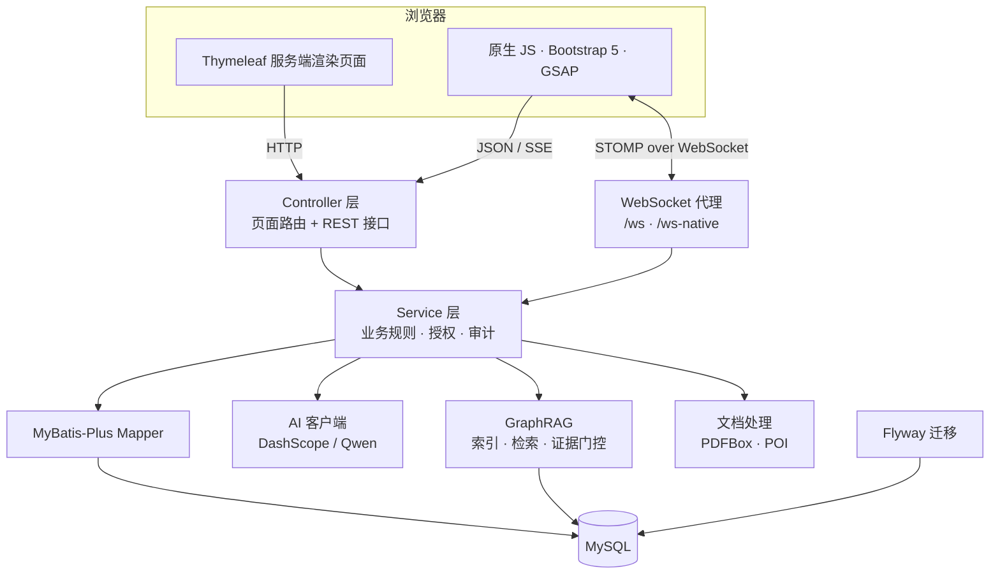
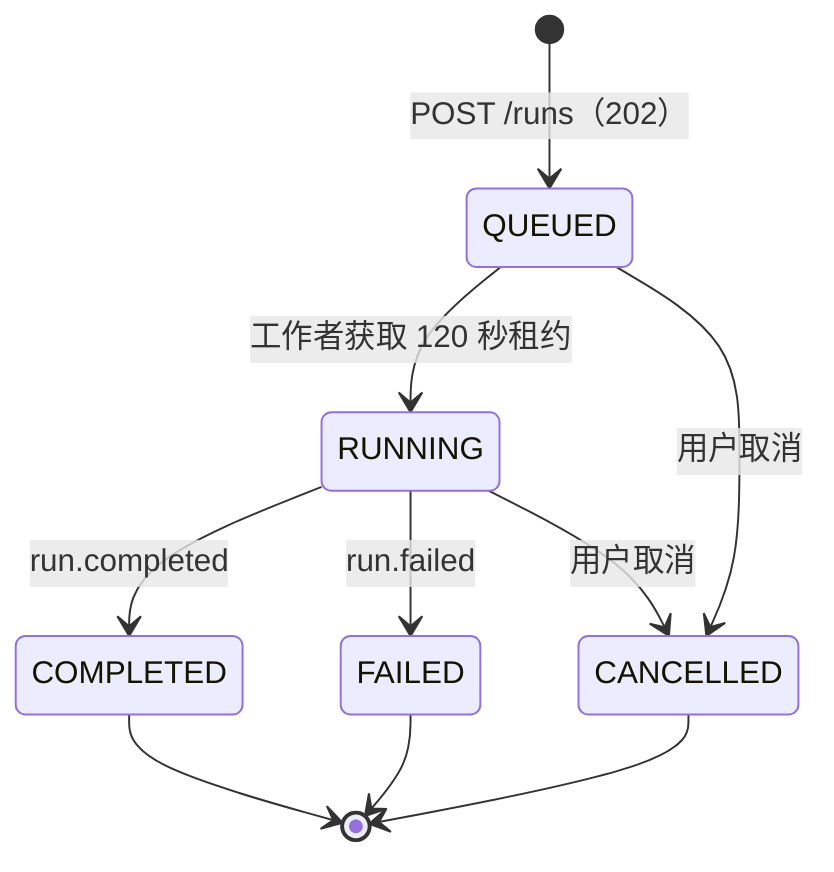

# iLink

> **同声相应，同气相求。**
> 面向高校师生的竞赛组队与团队协作平台。

[](https://openjdk.org/)
[](https://spring.io/projects/spring-boot)
[](https://www.mysql.com/)
[](LICENSE)


**简体中文** · [English](README.md)


<p align="center">
  <a href="http://121.40.34.68:8090"><strong>在线体验 »</strong></a>
  &nbsp;·&nbsp;
  <a href="#快速开始">本地运行</a>
  &nbsp;·&nbsp;
  <a href="#集成标准">集成标准</a>
  &nbsp;·&nbsp;
  <a href="docs/superpowers/specs/">设计文档</a>
</p>

---

## 目录

- [项目介绍](#项目介绍) — 项目背景、核心功能、创新亮点
- [架构介绍](#架构介绍) — 技术架构、核心模块、运行流程
- [集成标准](#集成标准) — 接口规范、错误码、流式协议、并发规则
- [快速开始](#快速开始) · [配置说明](#配置说明) · [接口与页面](#接口与页面)
- [安全与数据处理](#安全与数据处理) · [数据库迁移](#数据库迁移) · [部署](#部署)

## 项目介绍

### 项目背景

高校竞赛的成败，往往不在比赛当天，而在此之前那些琐碎却耗神的环节：

- **赛事信息分散。** 通知散落在官网、群聊和转发文档里，报名截止时间、参赛资格和材料要求很容易被漏掉。
- **组队靠临时拼凑。** 学生在群里发一句“找队友”，再私聊沟通技能、时间与分工。没有一个结构化的地方描述项目需要什么，也没有办法认真评估一个候选人。
- **组队之后协作割裂。** 任务在一个工具里，文档在另一个地方，文件沉在群聊记录中，最后提交材料还得手工重新拼起来。
- **AI 要么缺位，要么不可信。** 通用聊天机器人不知道团队的任务、文件和竞赛要求，给出的答案无法直接采用。

iLink 把这整条链路收进同一个工作台：**发现赛事 → 找到队友 → 团队协作 → 沉淀成果**。

### iLink 是什么

iLink 是一个服务端渲染的 Web 应用，分为两层：

1. **公开门户**：竞赛目录、组队大厅、导师墙、交流社区和成果展示。
2. **团队空间**：成员治理、任务与里程碑、实时群聊、协作资产（文档、表格、材料矩阵）以及 Agent 工作台。

每支团队从一条团队需求出发，在成员审核通过后进入协作状态，把任务、文档、文件和关键决策留在同一处，直到成果正式发布。

### 核心功能

| 模块 | 能力 |
| --- | --- |
| **发现与组队** | 按关键词/类别/状态筛选的组队大厅；结构化申请；团队邀请；带研究方向的导师墙与协作请求；管理员维护的竞赛目录；多频道社区；公开个人主页与成果展示 |
| **团队生命周期** | `OPEN` → `TEAMING` → `CLOSED`；审核、邀请、移除、转让队长与解散；软删除保留协作历史 |
| **团队空间** | 仅创建者与已通过成员可访问；五态任务看板（`PENDING`、`IN_PROGRESS`、`REVIEW`、`COMPLETED`、`CANCELLED`）；参与人、评论与提交物；里程碑与逾期识别；团队统计 |
| **实时协作** | 基于 WebSocket 的 STOMP 通信；群聊历史持久化；按用户的站内通知与未读数；协作资产只广播脱敏变更事件 |
| **协作资产** | Markdown 文档：自动保存、90 秒编辑租约、版本快照与恢复、ACL 与回收站；带列类型的团队表格与 CSV/XLSX 导出；材料矩阵把竞赛要求关联到证据并保留人工复核；正文异步抽取与团队范围检索索引 |
| **团队 Agent** | 会话持久化；态势/风险分析、周报草稿与任务动作建议；任何写入前必须人工确认；动作组整组事务执行；可审计；有限撤销；SSE 流式输出与可断点续传游标 |
| **GraphRAG** | 证据门控检索；固定 2 跳快速模式与 ReAct 深度搜索模式；SSE 流式输出；证据不足时保守降级 |
| **账号与治理** | `STUDENT` / `TEACHER` / `ADMIN`；注册仅限学生与教师；支持手机号、学号/工号、用户名或邮箱登录；BCrypt + Session；管理操作写审计日志 |

### 创新亮点

1. **带事务写入的人机协同 Agent。** Agent 永远不会直接改团队数据。它先产出 `action.proposed` 事件和可审阅的动作组；用户勾选并确认后，服务端重新校验权限与版本，把整组动作放进一个事务里执行，写入审计记录，并提供有边界的撤销能力。任一动作失败则整组失败，不会留下改到一半的状态。
2. **证据门控的 GraphRAG。** 回答之前先规划“需要哪些证据”，工具结果写入证据台账，最终答案必须与台账核对后才能输出。证据不足时明确说明并给出保守回答，而不是把模型猜测包装成平台事实。检索按既定顺序降级：向量检索 → 关键词检索 → 固定 2 跳图遍历。
3. **能扛住并发的协作原语。** 文档与表格使用乐观版本、哈希存储的 90 秒编辑租约与原子接管；冲突响应会告诉客户端当前谁持有租约、是否应切换为只读。
4. **所有界面共用一套契约。** 页面、JSON 接口、SSE 与 WebSocket 消息遵循同一套归属、错误与审计规则；容器层的 404/500 也会被归一成同样的 `Result<T>` 包装返回给 JSON 客户端。
5. **刻意“无聊”的运维形态。** 单个 Spring Boot 进程、Flyway 作为唯一表结构权威、内容指纹静态资源，以及生产环境启动时的显式校验。

### 界面预览

**公开门户**

| 首页 | 组队大厅 |
| --- | --- |
|  |  |
| **导师墙** | **交流社区** |
|  |  |
| **竞赛目录** | **成果展示** |
|  |  |

**团队空间**

| 任务看板与团队空间 | Agent 工作台 |
| --- | --- |
|  |  |
| **成员与智能匹配** | **管理后台** |
|  |  |

## 架构介绍

### 系统上下文



iLink 是一个分层单体，边界划分得很明确：**Thymeleaf 在服务端完成首屏渲染**，原生 JS 层负责交互、SSE 流与 WebSocket 订阅。Controller 只处理 HTTP 关注点，Service 承载业务规则与授权，MyBatis-Plus Mapper 负责持久化。MySQL 是唯一有状态的依赖，表结构只能由 Flyway 变更。

### 模块划分

| 模块 | 职责 | 实现要点 |
| --- | --- | --- |
| `controller` | 页面路由、REST 接口、SSE 端点 | `PageController` 只放行白名单页面；`GlobalExceptionHandler` 统一错误；`ErrorContractController` 兜底容器级错误 |
| `service` | 团队、用户、任务、通知、上传与 AI 编排 | 业务授权在这一层校验，不只依赖 URL 规则 |
| `service.ai` | 模型调用、Token 计量、联网搜索 | OpenAI 兼容的 DashScope 客户端；对话与向量模型分离；Key 可缺省 |
| `service.kg` | GraphRAG 索引、检索、证据门控、工具 | 分块、向量化、2 跳遍历、带硬预算的 ReAct 循环 |
| `collab` | 文档、表格、材料矩阵、租约、ACL、回收站 | 版本化资产、哈希租约令牌、CSV/XLSX 导出、异步索引桥 |
| `teamagent` | 会话、运行队列、SSE 事件、动作组、撤销 | 每次运行一条持久化事件日志；租约式工作者；严格请求记录 |
| `security` | 登录、记住我、WebSocket 授权 | 会话固定防护、BCrypt、CSRF Cookie 令牌、订阅级校验 |
| `mapper` / `entity` | 持久化与数据模型 | MyBatis-Plus，显式表/列映射 |
| `config` | 安全、MVC、WebSocket、缓存、生产校验 | 生产配置不安全时拒绝启动 |

### 运行流程

**HTTP 请求生命周期**

```text
浏览器 → Spring Security 过滤器链
       → CSRF / 会话 / 角色校验
       → Controller（Result<T>）
       → Service（业务授权、事务）
       → MyBatis-Plus Mapper → MySQL
       → JSON Result<T>，或页面路由返回 Thymeleaf 视图
```

页面路由由 `PageController` 按固定的 `ALLOWED_PAGES` 集合解析，未登记的名称返回项目自己的 404 页。安全规则集中写在 `SecurityConfig`，因此新增页面或接口若需要公开访问，必须两处同时登记。

**团队 Agent 运行生命周期**



运行任务进入有界队列（默认容量 32），由固定工作线程池（默认 4）执行。每次状态变化都会追加到运行级事件日志，序号单调递增。浏览器用 `<runId>:<seq>` 游标通过 SSE 消费日志，因此断线重连既不会重复也不会丢事件。

**动作提议与确认**

```text
Agent 运行
  → action.proposed 事件（动作组版本 N）
  → 用户审阅并勾选动作
  → POST /action-groups/{id}/confirm
      · 重新校验成员身份与权限
      · 重新校验期望的动作组版本
      · 在一个事务内执行全部选中动作
      · 追加审计记录
  → EXECUTED（或 FAILED，且不产生部分写入）
  → 可选的有界撤销
```

**证据门控的回答链路**

```text
问题
  → 证据规划（需要证明什么）
  → 检索：向量 → 关键词 → 固定 2 跳图遍历
  → 证据台账（带来源的工具结果）
  → 生成答案
  → 证据核对
  → 答案 + 引用，或保守的“证据不足”响应
```

ReAct 深度模式受 5 轮、8 次工具调用、45 秒三重上限约束。所有上限都在服务端强制执行，模型无法自行延长预算。

### 数据模型

| 概念 | 存储 | 说明 |
| --- | --- | --- |
| 团队 | `team_demand` | 需求行本身就是团队，生命周期状态也在同一行 |
| 成员 | `team_application` 中 `status = APPROVED` | 申请与邀请共用一张表；`initiator_id = user_id` 表示本人申请；`uk_team_user` 要求写入时 upsert |
| 导师档案 | `teacher_application` | 教师账号自动建档案，管理员审核 |
| 任务 / 里程碑 | `task`、`project_milestone` | 五态任务看板；里程碑进度由关联任务推导 |
| 协作资产 | `team_document`、`team_spreadsheet`、`material_*` | 版本行、ACL 行、租约行与软删除/回收站元数据 |
| Agent 状态 | `team_agent_conversation`、`team_agent_run`、`team_agent_run_event`、`team_agent_action_*` | 持久化事件日志是流式输出与恢复的事实来源 |
| 知识图谱 | `kg_*` 表 | 分块、实体、关系与事实来源 |
| 平台数据 | `user`、`community_post`、`asset`、`competition`、`notification`、`audit_log` | 门户内容与治理数据 |

### 部署拓扑

```text
客户端 ──HTTPS──▶ Nginx / 1Panel ──▶ Spring Boot（单节点，端口 8090）──▶ MySQL
                                          │
                                          ├── 本地上传目录（/uploads）
                                          └── DashScope API（可选）
```

当前目标是单应用节点。生产环境下静态资源带内容指纹，可长期缓存；上传文件因为可能被同名替换，只缓存 1 小时。水平扩展需要共享会话与 WebSocket 粘性路由，目前并未内置。

## 集成标准

本节定义任何客户端、模块或服务接入 iLink 时需要遵守的契约。运行中的代码与 Flyway 迁移是最终事实来源，本节描述的是它们强制执行的约束。

### 1. 传输与约定

| 项目 | 标准 |
| --- | --- |
| 协议 | 同源 HTTP/1.1；生产环境使用 HTTPS |
| 请求体格式 | JSON（`application/json`），UTF-8 |
| 路径风格 | 资源化前缀位于 `/api/**`；页面路由为 `/{page}.html` |
| 版本策略 | 基于路径；优先做增量变更，破坏性变更必须启用新路径 |
| 时间 | 包装字段 `timestamp` 用毫秒时间戳；业务时间用 ISO-8601 字符串 |
| 分页 | 按领域使用 `page`/`size` 或 cursor/offset；分页元数据统一放在 `extra.pagination` |
| 未知请求字段 | Agent 请求记录会拒绝未知字段（`@JsonIgnoreProperties(ignoreUnknown = false)`），视为客户端缺陷而不是静默忽略 |

### 2. 响应包装

所有 JSON 接口返回同一个包装：

```json
{
  "code": 200,
  "message": "OK",
  "data": {},
  "extra": {},
  "timestamp": 1760000000000
}
```

| 字段 | 含义 |
| --- | --- |
| `code` | 业务/状态码。`200` 表示成功；出错时与 HTTP 状态码一致 |
| `message` | 可直接展示给用户的提示 |
| `data` | 业务数据；无返回体的命令为 `null` |
| `extra` | 机器可读元数据：`pagination`、`errorCode`、`retryable`、`requestId`、冲突详情 |
| `timestamp` | 服务端毫秒时间戳 |

分页元数据：

```json
{
  "extra": {
    "pagination": { "page": 1, "size": 20, "total": 137 }
  }
}
```

`Result.toHttpStatus()` 会把 `code` 映射成 HTTP 状态码，客户端可以同时参考状态行与包装体，但两者都应读取。

### 3. 认证与授权

| 机制 | 说明 |
| --- | --- |
| 认证 | Spring Security 表单登录；登录用户存放在 HTTP Session，并以 `user` 属性暴露 |
| 密码存储 | BCrypt |
| 会话保护 | 登录时迁移会话（防会话固定）；记住我令牌使用后轮换，登出或改密时吊销 |
| 角色 | `STUDENT`、`TEACHER`、`ADMIN`；`/admin.html` 与 `/api/admin/**` 要求 `ROLE_ADMIN` |
| 默认规则 | 除显式放行外，所有请求都需要认证 |
| 公开读取 | `GET /api/community/posts*`、`GET /api/teacher/list`、`GET /api/teacher/{id}`、`GET /api/team/list`、`GET /api/team/{id}`、`GET /api/asset/list`、`GET /api/asset/{id}`、`GET /api/competitions`、`/api/user/public/**`、`/api/user/skills/public/**` |
| 公开页面 | 首页、竞赛、社区与文章页、导师墙、组队大厅、成果展示、公开个人主页、详情页与团队空间外壳 |
| 未登录调用接口 | 返回 `401` + JSON `Result`；浏览器页面请求会重定向到 `/login.html?redirect=<编码后的目标>` |
| 角色不足 | 接口请求返回 `403` + JSON `Result` |

业务级授权不只依赖 URL 规则。团队身份、资产 ACL、团队状态与编辑权限在每次操作时都会在 Service 层重新校验。

### 4. CSRF

| 项目 | 标准 |
| --- | --- |
| 令牌存放 | `XSRF-TOKEN` Cookie（`HttpOnly = false`，同源 JS 可读） |
| 请求头 | 所有写操作（`POST`、`PUT`、`PATCH`、`DELETE`）携带 `X-XSRF-TOKEN` |
| 豁免范围 | 仅 WebSocket 握手 `/ws/**` 与 `/ws-native/**`；上传与文件接口**不豁免** |
| 客户端规则 | 所有 AJAX 走共享的 `apiFetch`，自动携带凭据与 CSRF 头 |

令牌缺失或过期会在认证之前失败，可能表现为 `403`；从 Cookie 重新读取令牌后重试一次即可。

### 5. 错误契约

`GlobalExceptionHandler` 把异常映射为稳定的 HTTP 状态与提示：

| 场景 | 状态码 | `extra.errorCode` |
| --- | --- | --- |
| 校验失败（`@Valid`、`@Validated`） | 400 | — |
| JSON 请求体缺失或格式错误 | 400 | — |
| 缺少必要参数 | 400 | — |
| 参数类型不匹配 | 400 | — |
| 唯一键冲突 / 约束违规 | 400 | — |
| 上传超过大小限制 | 400 | — |
| Content-Type 不支持 | 415 | — |
| HTTP 方法不支持 | 405 | — |
| 拒绝访问 | 403 | — |
| 团队 Agent 领域错误 | 由错误码映射 | `TeamAgentErrorCode` 名称 |
| 协作资产领域错误 | 由错误码映射 | `TeamCollabException.Code` 名称 |
| 未处理的服务端错误 | 500 | — |

Agent 错误会附带机器可读信息：

```json
{
  "code": 409,
  "message": "运行已在执行中",
  "extra": {
    "errorCode": "RUN_ALREADY_ACTIVE",
    "requestId": "…",
    "retryable": true
  }
}
```

`retryable` 为 `false` 时原样重试没有意义；为 `true` 时应退避重试，并遵守响应中的 `Retry-After`。

**Agent 错误码分组**（`TeamAgentErrorCode`）：

- 认证/授权：`AUTH_REQUIRED`、`TEAM_ACCESS_DENIED`、`AGENT_ACTIONS_DISABLED`
- 请求合法性：`REQUEST_INVALID`、`SENSITIVE_INPUT_REJECTED`、`ACTION_SELECTION_INVALID`
- 状态缺失：`CONVERSATION_NOT_FOUND`、`RUN_NOT_FOUND`、`ACTION_GROUP_NOT_FOUND`、`ACTION_NOT_FOUND`
- 并发冲突：`CONVERSATION_BUSY`、`RUN_ALREADY_ACTIVE`、`IDEMPOTENCY_KEY_REUSED`、`ACTION_DUPLICATE`、`ACTION_VERSION_CONFLICT`、`ACTION_PERMISSION_CHANGED`
- 生命周期：`RUN_NOT_CANCELLABLE`、`ACTION_GROUP_EXPIRED`、`ACTION_ALREADY_FINALIZED`、`UNDO_NOT_AVAILABLE`、`UNDO_EXPIRED`、`UNDO_CONFLICT`、`UNDO_ALREADY_FINALIZED`
- 容量与上游：`AGENT_CAPACITY_EXCEEDED`、`AGENT_RATE_LIMITED`、`AGENT_BUDGET_EXCEEDED`、`AI_TIMEOUT`、`AI_RATE_LIMITED`、`AI_UPSTREAM_FAILED`、`AI_NOT_CONFIGURED`、`MODEL_OUTPUT_INVALID`
- 执行：`WORKER_LOST`、`ACTION_TRANSACTION_FAILED`、`ACTION_SCHEMA_UNSUPPORTED`

**协作资产错误码**（`TeamCollabException.Code`）：`TEAM_NOT_FOUND`、`TEAM_READ_ONLY`、`ASSET_NOT_FOUND`、`ASSET_FORBIDDEN`、`EDIT_LEASE_HELD`、`EDIT_LEASE_INVALID`、`EDIT_LEASE_EXPIRED`、`EDIT_VERSION_CONFLICT`、`REQUEST_ID_REUSED`、`CONTENT_TOO_LARGE`、`SPREADSHEET_SCHEMA_INVALID`、`EXPORT_FAILED`、`FILE_INDEX_FAILED`、`MATERIAL_EVIDENCE_INVALID`、`AGENT_ACTION_CONFLICT`、`REQUEST_INVALID`。

协作错误响应带 `Cache-Control: no-store, must-revalidate`，避免客户端或代理复用已经过期的权限判断。

### 6. 并发、租约与幂等

| 机制 | 契约 |
| --- | --- |
| 乐观版本 | 读取资产后，写请求携带 `baseVersion`；不匹配返回 `409` + `EDIT_VERSION_CONFLICT` |
| 编辑租约 | `POST /collaboration/{assetType}/{assetId}/lease` 获取 **90 秒**租约并返回 `leaseToken`；用 `PUT` 续租，用 `DELETE` 释放 |
| 租约冲突 | `409 EDIT_LEASE_HELD` 返回 `extra.activeLease` 与 `extra.readOnly: true`，客户端应切换只读而不是强行写入 |
| 租约安全 | 租约令牌只存哈希，且从不写入审计日志 |
| 幂等 | 写命令携带 `clientRequestId`；相同标识重复提交会返回冲突（`REQUEST_ID_REUSED` / `IDEMPOTENCY_KEY_REUSED`），不会重复执行 |
| 动作组 | 确认时携带 `expectedGroupVersion`；撤销时携带 `expectedActionVersion`；版本过期返回 `409` |
| Agent 运行租约 | 工作者租约默认 120 秒；工作者丢失后运行会被恢复并标记失败或取消，不会静默重复执行 |

推荐的客户端循环：

```text
获取租约 → 带 leaseToken + baseVersion 编辑
  → 保存 → 得到新版本并续租
  → 遇到 409：刷新资产，丢弃或合并本地改动，重新获取租约
  → 失焦/关闭时释放租约
```

### 7. Server-Sent Events（SSE）

**Agent 运行流**

```http
GET /api/team/{teamId}/agent/runs/{runId}/events
Accept: text/event-stream
Last-Event-ID: <runId>:<seq>
```

| 项目 | 标准 |
| --- | --- |
| 游标 | `Last-Event-ID` 采用 `<runId>:<seq>` 形式，或使用 `?afterSeq=<seq>` |
| 事件 `id` | 与游标相同的 `<runId>:<seq>` |
| 心跳 | 每 15 秒发送一条 SSE 注释；注释不携带事件 id，也不落库 |
| 轮询 | 服务端每 300 ms 轮询持久化事件日志，客户端无需自行轮询 |
| 顺序 | 同一运行内 `seq` 严格递增 |
| 续传 | 用最后收到的事件 id 重连，服务端只补发之后的事件 |
| 终止事件 | `run.completed`、`run.failed`、`run.cancelled` 会关闭流 |
| 建流前失败 | 返回 HTTP 状态码 + `X-Team-Agent-Error-Code`（必要时附 `Retry-After`）；响应体为空，因为 `EventSource` 期待的是流 |
| 代理 | `Cache-Control: no-store`、`X-Accel-Buffering: no` |

事件类型：

| 事件 | 含义 |
| --- | --- |
| `context.ready` | 团队上下文与聚焦任务已组装完成 |
| `run.started` | 工作者已接管该运行 |
| `tool.started` | 开始一次检索/工具调用 |
| `message.delta` | 增量答案文本 |
| `action.proposed` | 动作组已生成，等待人工审阅 |
| `run.completed` | 运行成功结束（终止） |
| `run.failed` | 运行失败并带稳定原因（终止） |
| `run.cancelled` | 运行被取消（终止） |

**GraphRAG 流**：`POST /api/ai/graph-rag/agentic-query/stream` 同样返回 `text/event-stream`，遵循相同的禁缓冲与禁缓存规则。

### 8. WebSocket / STOMP

| 项目 | 标准 |
| --- | --- |
| 端点 | `/ws`（SockJS）与 `/ws-native`（原生 WebSocket） |
| 代理 | 简单代理监听 `/topic` 与 `/queue`；应用前缀 `/app` |
| 群聊发送 | `/app/chat/{teamId}` |
| 群聊订阅 | `/topic/team/{teamId}` |
| 协作广播 | 只广播脱敏的 `COLLABORATION_CHANGED` 事件，不含文档正文或租约令牌 |
| 授权 | 连接时与每次订阅时都校验认证状态与团队成员身份 |
| CSRF | WebSocket 握手是唯一豁免 CSRF 的路径 |

### 9. 文件上传

```http
POST /api/upload/attachment
Content-Type: multipart/form-data

file=<binary>&kind=proof
```

| 项目 | 标准 |
| --- | --- |
| 表单字段 | `file` |
| 可选参数 | `kind`，默认 `proof` |
| 大小限制 | 单文件 50 MB，单请求 100 MB；头像、图片、证书、证明与封面另有更小限制 |
| 校验 | 扩展名、声明大小、文件签名与规范化路径 |
| 访问 | `/uploads/**` 公开可读，但只应暴露被业务记录引用的文件 |
| 缓存 | 上传文件使用 `Cache-Control: public, max-age=3600`，因为它们可能被替换 |

### 10. 扩展系统

| 变更类型 | 必做步骤 |
| --- | --- |
| 新增页面 | 添加模板，把名称加入 `PageController.ALLOWED_PAGES`；若需公开访问，同时在 `SecurityConfig` 登记路由 |
| 新增 REST 接口 | Controller 返回 `Result<T>`，Service 做业务授权，按需新增 Mapper/实体，并为新表/新列写 Flyway 迁移 |
| 新增表结构 | 在 `src/main/resources/db/migration/` 新增版本化迁移；已执行的迁移绝不能修改 |
| 新增错误码 | 加入对应枚举，并声明 HTTP 状态与 `retryable`；客户端依赖枚举名 |
| 新增 Agent 命令 | 增加严格请求记录，校验成员与版本，写审计记录，并保证写入在事务内 |
| 新增前端资源 | 用 `th:href="@{/css/x.css}"` 引用，内容指纹解析器会自动加哈希 |
| 新增文案 | 同时补充 `messages.properties` 与 `messages_en.properties` |

### 11. 版本与兼容

- **表结构**：Flyway 版本号只追加不修改。`src/main/resources/db/migration/` 是唯一事实来源（当前 51 个 SQL 迁移，V0_5–V51，另有 Java 迁移 V3）。
- **接口**：可以自由新增字段与端点；不要改变既有字段或错误码的含义。破坏性变更必须启用新路径。
- **事件**：SSE 事件名与 `errorCode` 是机器契约，只新增不重命名。
- **静态资源**：内容指纹 URL 视为不可变；新构建会生成新哈希，无需手动清缓存。

## 快速开始

### 环境要求

- JDK 17 或更高版本
- Maven 3.9 或更高版本
- MySQL 5.7 或 MySQL 8

### 1. 创建数据库

```sql
CREATE DATABASE ilink
  DEFAULT CHARACTER SET utf8mb4
  COLLATE utf8mb4_unicode_ci;
```

不要先执行 `sql/schema.sql`。启动时由 Flyway 自动执行 `src/main/resources/db/migration/`。

### 2. 配置环境

默认激活 `dev` profile，监听 `8090` 端口。至少需要提供数据库密码：

```powershell
$env:DB_HOST = "localhost"
$env:DB_PORT = "3306"
$env:DB_USERNAME = "root"
$env:DB_PASSWORD = "你的数据库密码"
$env:FILE_UPLOAD_DIR = "E:\data\ilink\uploads"
```

AI 与推送凭据只放在本机：

```powershell
Copy-Item src/main/resources/application-local.yml.example src/main/resources/application-local.yml
```

`application-local.yml` 已被 git 忽略。不要提交真实凭据。AI 功能读取 `DASHSCOPE_API_KEY` / `EMBEDDING_API_KEY`。

### 3. 启动

```bash
mvn spring-boot:run
```

打开 [http://localhost:8090](http://localhost:8090)。

### 4. 导入演示数据（可选）

`sql/demo_showcase_seed.sql` 提供可重复执行的演示团队、导师、帖子和成果：

```bash
mysql -uroot -p --default-character-set=utf8mb4 ilink < sql/demo_showcase_seed.sql
```

演示密码写在脚本顶部。不要把演示数据导入生产环境。

### 5. 测试与打包

```bash
mvn test
mvn clean package
java -jar target/iLink-1.0.jar
```

测试使用 `test` profile 与内存 H2 数据库，不需要本地 MySQL。`TeamCollaborationMysqlIT` 是可选的真实 MySQL 集成测试，默认跳过。

## 配置说明

大部分配置可以通过环境变量提供：

| 变量 | 用途 | 默认值 / 说明 |
| --- | --- | --- |
| `SERVER_PORT` | HTTP 端口 | `8090` |
| `SPRING_PROFILES_ACTIVE` | Spring profile | `dev` |
| `DB_HOST`、`DB_PORT`、`DB_USERNAME`、`DB_PASSWORD` | MySQL 连接 | `DB_PASSWORD` 也可用 `SPRING_DATASOURCE_PASSWORD` |
| `FILE_UPLOAD_DIR` | 上传根目录 | `./uploads` |
| `FILE_ACCESS_URL_PREFIX` | 上传访问前缀 | `/uploads/` |
| `APP_PUBLIC_BASE_URL` | 应用公网地址 | 用于密码重置与反馈链接；生产必须是 HTTPS |
| `DASHSCOPE_API_KEY`、`DASHSCOPE_BASE_URL`、`DASHSCOPE_MODEL` | 对话 / 抽取模型 | OpenAI 兼容端点；没有 Key 时 AI 不可用 |
| `EMBEDDING_API_KEY`、`EMBEDDING_BASE_URL`、`EMBEDDING_MODEL` | 图谱向量检索 | 未配置时降级为关键词检索 |
| `AI_ENABLED`、`AI_SEARCH_ENABLED`、`AI_SEARCH_MAX_RESULTS` | AI 与联网搜索开关 | 默认开启；搜索返回 5 条 |
| `TEAM_AGENT_ENABLED`、`TEAM_AGENT_ACTIONS_ENABLED`、`TEAM_AGENT_DEEP_GRAPH_RAG_ENABLED` | 团队 Agent 能力 | 默认开启 |
| `TEAM_AGENT_WORKER_CONCURRENCY`、`TEAM_AGENT_QUEUE_CAPACITY`、`TEAM_AGENT_LEASE_SECONDS` | Agent 运行队列 | 4 / 32 / 120 秒 |
| `RESEND_API_KEY`、`APP_MAIL_FROM`、`SPRING_MAIL_HOST` | 邮件通道 | 优先 Resend；生产仍需要 SMTP 主机 |
| `SERVERCHAN_SENDKEY`、`FEEDBACK_PUSH_ENABLED` | 反馈推送 | 未配置推送时反馈仍会落库 |
| `SESSION_COOKIE_SECURE` | Session Cookie 安全标记 | 生产应为 `true` |

生产环境请显式使用 `prod` profile。启动时会校验：数据库账号非 root、数据库密码非默认值、公网地址为 HTTPS、SMTP 可用、发件地址合法、上传目录为绝对路径、Session Cookie 安全；任一校验失败即拒绝启动。

## 接口与页面

| 领域 | 前缀 | 说明 |
| --- | --- | --- |
| 认证 | `/api/login`、`/api/register`、`/api/logout`、`/api/password-reset/**` | 登录、注册、登出、找回密码 |
| 用户与技能 | `/api/user/**`、`/api/user/skills/**` | 资料、密码、公开主页、头像、技能 |
| 团队与成员 | `/api/team/**` | 发布、申请、审核、邀请、管理、转让、解散 |
| 团队协作 | `/api/team-space/**`、`/api/tasks/**`、`/api/milestones/**` | 概览、任务、提交物、评论、里程碑 |
| 协作资产 | `/api/team/{teamId}/collaboration/**`、`/documents/**`、`/spreadsheets/**`、`/materials/**` | 文档、表格、材料矩阵、租约、ACL、回收站 |
| 团队资料库 | `/api/team/{teamId}/library/**` | 文件夹、文件、预览、索引状态、回收站 |
| 团队 Agent | `/api/team/{teamId}/agent/**` | 会话、运行、SSE 事件、动作组确认/忽略/撤销 |
| 聊天与通知 | `/api/team/{teamId}/messages`、`/api/notifications/**` | 历史/发送与通知中心 |
| 社区与成果 | `/api/community/**`、`/api/asset/**` | 帖子、互动、评论、成果、下载 |
| 导师、竞赛、推荐 | `/api/teacher/**`、`/api/competitions`、`/api/recommendations/**` | 导师资料、目录、匹配 |
| AI | `/api/team/{teamId}/ai/task-breakdown`、`/api/ai/competition-qa`、`/api/ai/graph-rag/**` | 任务拆解建议、竞赛答疑、SSE 问答、GraphRAG |
| 反馈与管理 | `/api/feedback`、`/api/admin/**` | 全站反馈、后台管理与审计 |

常用页面路由：

```text
/index.html             首页
/team-market.html       组队大厅
/teacher-wall.html      导师墙
/community.html         交流社区
/competitions.html      竞赛目录
/gallery.html           成果展示
/team-space.html        团队空间（看板、群聊、成员、资产、Agent）
/team-review.html       任务审阅工作台
/roster.html            成员名册
/user-profile.html      公开个人主页
/profile.html           个人中心
/admin.html             管理后台
```

运维端点：`/actuator/health` 公开；其余 Actuator 端点默认不暴露。类路径中带有 SpringDoc OpenAPI 1.7.0，会生成 `/v3/api-docs` 与 `/swagger-ui.html`；这些路径未加入白名单，因此沿用默认的“需要认证”规则。

## 项目结构

```text
.
├── src/
│   ├── main/
│   │   ├── java/cn/ilink/
│   │   │   ├── config/       # 安全、缓存、MVC、WebSocket、生产校验
│   │   │   ├── controller/   # 页面路由与 REST 接口
│   │   │   ├── service/      # 业务规则、通知、上传
│   │   │   │   ├── ai/       # 模型调用、用量、预算、联网搜索
│   │   │   │   └── kg/       # GraphRAG 索引、检索、证据门控、工具
│   │   │   ├── collab/       # 团队文档、表格、材料矩阵、索引桥
│   │   │   ├── teamagent/    # Agent 会话、运行、SSE、动作命令
│   │   │   ├── mapper/       # MyBatis-Plus 数据访问
│   │   │   ├── entity/       # 持久化实体
│   │   │   ├── dto/、vo/     # 请求与响应模型
│   │   │   ├── security/     # 登录、记住我、WebSocket 授权
│   │   │   └── util/         # 密码、HTML、IP、缓存工具
│   │   └── resources/
│   │       ├── db/migration/ # Flyway 迁移（V0_5–V51 + Java V3）
│   │       ├── static/       # CSS、JavaScript、图片与第三方资源
│   │       ├── templates/    # Thymeleaf 页面与片段
│   │       └── application*.yml
│   └── test/java/            # 单元、控制器、安全与路由契约测试
├── sql/                      # 历史/手工 SQL 与演示数据
├── docs/                     # 设计文档、评测报告、部署说明
└── assets/readme/            # README 截图与演示动图
```

## 测试

```bash
mvn test
```

- 单元、控制器、安全与路由契约测试基于 H2，开箱即跑。
- 真实 MySQL 集成测试 `TeamCollaborationMysqlIT` 默认跳过，需要时显式启用。
- 新行为请补充单元或 Web 层测试。不要为了通过构建而删除或跳过测试。

## 安全与数据处理

- Spring Security + BCrypt + Session 认证，包含会话固定防护。
- 写操作使用 Cookie CSRF 令牌（`X-XSRF-TOKEN`）；只有 WebSocket 握手豁免。
- 记住我令牌持久化、使用后轮换，登出或改密时吊销。
- 连续登录失败会触发临时锁定。找回密码不暴露账号是否存在；令牌哈希存储且一次性使用。
- 社区富文本使用 Jsoup 白名单清洗。上传按扩展名、大小、文件签名与规范化路径校验。
- 通用上传限制为单文件 50 MB、单请求 100 MB；头像、图片、证书、证明与封面限制更小。
- 管理后台对用户、角色、团队、导师、成果、社区与竞赛的操作均写审计日志。
- 团队文档、表格、材料与资料库文件会校验团队状态、资产范围与 ACL。编辑使用 90 秒租约与乐观锁。
- Agent 动作必须人工确认，整组事务执行；审计只记录动作与结果，不保存正文或租约令牌。
- 团队材料异步抽取；PDF/Office 解析有页数、单元格与大小上限。加密、损坏或无法安全解析的压缩包会标记为未索引。
- 响应包含 CSP、`nosniff`、`X-Frame-Options`、`Referrer-Policy` 与 `Permissions-Policy`。CSP 的脚本源只允许 `'self'`、`'unsafe-inline'` 与 `https://cdn.jsdelivr.net`。
- `app.api.expose-error-detail` 默认 `false`，内部提示与 SQL 细节不会返回给客户端。

## 数据库迁移

`src/main/resources/db/migration/` 是表结构的唯一事实来源。当前包含 51 个 SQL 迁移（V0_5–V51）以及 Java 迁移 V3，最新版本为 V51。

`sql/` 目录是历史 DDL、兼容修复与演示脚本，永不自动执行。只有在查看目标库的 `flyway_schema_history`、完成备份并确认影响范围之后，才可以手工执行。参见 [sql/README.md](sql/README.md)。

## 部署

- 使用 `prod` profile 启动，并满足上文所有启动校验。
- 通过 Nginx 或 1Panel 等面板暴露 HTTPS；`APP_PUBLIC_BASE_URL` 必须是公网 HTTPS 地址。
- 上传目录使用绝对路径，并确保运行账号可写。数据库不要以 root 运行。
- 静态资源带内容指纹（`/css/x-<md5>.css`），生产环境可长期缓存。
- 单节点即可运行 iLink。水平扩展需要共享会话与 WebSocket 粘性路由。

在线体验：[http://121.40.34.68:8090](http://121.40.34.68:8090)

项目介绍页（应用内“关于作者”入口）：
<https://su-yu-s.github.io/iLink-cn/>

## 已知限制

- 竞赛目录由管理员维护，不抓取赛事官网。
- AI 问答与 GraphRAG 需要 DashScope / Qwen 凭据；未配置时这些功能不可用，其余功能不受影响。
- 团队资料索引是异步的，较大或复杂的 Office 文件需要更长时间才能被检索到。
- 当前部署目标是单节点，未内置多租户与集群会话。
- SpringDoc 虽然存在，但未整理为公开 API 文档；本 README 的集成契约才是权威描述。

## 参与贡献

欢迎提交 Issue 与 Pull Request。

1. Fork 仓库并从 `main` 拉出分支。
2. 保持改动聚焦，遵循现有的分层、命名与样式约定。
3. 表结构变更通过 Flyway 迁移交付，不要依赖手工改表。
4. 提交前运行 `mvn test`。界面改动请附截图或录屏。
5. commit message 使用简洁中文。不要提交密钥、数据库密码、上传文件或本地 `application-local.yml`。

设计文档位于 [`docs/superpowers/specs/`](docs/superpowers/specs/)；运行中的代码与迁移才是最终依据。

## 许可证

iLink 采用 [PolyForm Noncommercial License 1.0.0](LICENSE) 发布。

| 范围 | 条款 |
| --- | --- |
| **允许** | 学术研究、教学、个人学习及其他非商业用途；可修改并再分发，但须让接收方获得本条款 |
| **不允许** | 商业用途：出售本软件或基于它提供的服务，或在营利组织中用于获取商业利益 |
| **商业授权** | 需另行签署书面许可；可提交 Issue 联系 |
| **第三方代码** | 依赖项保留各自许可证（Spring Boot、MyBatis-Plus、Flyway 等） |

这是源码可见许可，不是 OSI 认可的开源许可。参与贡献即表示你同意贡献内容按相同条款授权。2026-10-31 之前发布的版本，仍按其发布时的 Apache License 2.0 继续可用。

## 致谢

iLink 站在优秀开源项目的肩上：Spring Boot、Spring Security、Thymeleaf、MyBatis-Plus、Flyway、Caffeine、Jsoup、Apache PDFBox、Apache POI、GSAP 与 Bootstrap。AI 能力由阿里云百炼 DashScope 上的 Qwen 模型提供。

---

<p align="center">
  <sub>为每一次组队，找到频率相近的人。</sub>
</p>
