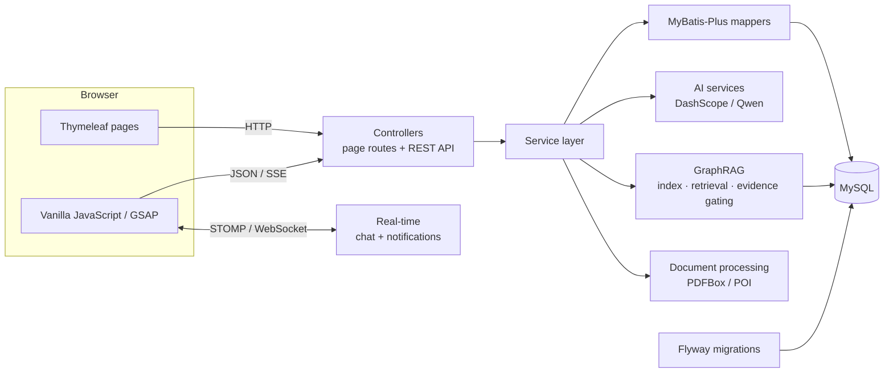

# iLink

> **Kindred minds find each other.**
> A competition teaming and collaboration platform for universities.

[](https://openjdk.org/)
[](https://spring.io/projects/spring-boot)
[](https://www.mysql.com/)
[](LICENSE)


[简体中文](README.md) · **English**


<p align="center">
  <a href="http://121.40.34.68:8090"><strong>Live Demo »</strong></a>
  &nbsp;·&nbsp;
  <a href="#quick-start">Run Locally</a>
  &nbsp;·&nbsp;
  <a href="docs/superpowers/specs/">Design Docs</a>
</p>

---

## Why iLink

The hard part of a university competition is rarely the competition itself. Event information is scattered across official sites, teammates are assembled through group chats and spreadsheets, and once a team forms, tasks, documents and conversations end up in yet another set of tools. iLink connects the whole journey — **discover an event → find teammates → collaborate as a team → publish the outcome** — in one workspace, from the first hello to the final defense.

The platform does not scrape event sites. Competition listings, dates and links are maintained by administrators. AI features only use the team material you are allowed to access and public competition information.

## Features

### Discover and team up

- **Team marketplace**: browse teams by keyword, category and status; students apply, team leaders review and approve.
- **Mentor wall**: browse approved teacher profiles, reach out by research direction and submit collaboration requests.
- **Competition catalog**: searchable, paginated listings maintained by administrators.
- **Community**: four channels (general, tech, competitions, resources) with posts, comments, likes, favorites and personal article management.
- **Showcase**: browse public project outcomes; signed-in users can publish, maintain and share their work.
- **Public profiles**: share bio, skills, honors, articles and outcomes.

### End-to-end teamwork

- **Team lifecycle**: `OPEN` → `TEAMING` → `CLOSED`; a team automatically enters collaboration mode when enough members are approved.
- **Member governance**: invite, approve, remove, transfer ownership and dissolve a team (soft-deleted, collaboration history preserved).
- **Team space**: only the creator and approved members can access team info, members, tasks and statistics.
- **Task board**: five states (`PENDING`, `IN_PROGRESS`, `REVIEW`, `COMPLETED`, `CANCELLED`) with assignment, participants, comments, submissions and review.
- **Milestones**: deadlines, deliverables and completion rates, with automatic pending / in-progress / completed / overdue states.
- **Real-time communication**: team chat over STOMP/WebSocket, persisted history and notifications, unread counts and per-user push.

### Collaboration assets

- **Team documents**: Markdown documents with autosave, edit leases, version snapshots, restore, export and trash; visible to the whole team or restricted by ACL.
- **Team spreadsheets**: typed columns, row/column editing, version restore, CSV/XLSX export and trash.
- **Material matrix**: link competition requirements to files, documents, spreadsheets and task evidence. System suggestions stop at “needs review”; humans confirm `MET` / `PARTIAL` / `MISSING`.
- **Content indexing**: PDF, Office, Markdown, text and spreadsheet content is extracted asynchronously into a team-scoped retrieval index and stops being searchable after deletion or permission loss.

### Agent workbench and GraphRAG

- **Team Agent**: persist team Q&A, situation and risk analysis, weekly report drafts, and task/collaboration action proposals per conversation.
- **Human confirmation**: every action must be confirmed by a user before it is written; action groups run transactionally, are auditable and can be partially undone.
- **Two retrieval modes**: fixed 2-hop quick answers and a ReAct deep search loop (up to 5 rounds, 8 tool calls, 45 seconds), with SSE streaming.
- **Evidence gating**: required evidence is planned first, tool results are written to an evidence ledger, and answers are verified before output. When evidence is insufficient, the system degrades conservatively instead of presenting unsupported claims as platform facts.
- **Graceful degradation**: keyword retrieval when embeddings are not configured; fixed 2-hop retrieval when ReAct fails; model knowledge as a last resort when the graph has no matches.

### Accounts and governance

| Role | Responsibilities |
| --- | --- |
| `STUDENT` | Register, complete profile, find teams/mentors, collaborate, publish community posts and outcomes |
| `TEACHER` | Maintain a mentor profile, handle student requests, collaborate with teams |
| `ADMIN` | Manage users, roles, teams, mentors, outcomes, community and competition catalog; actions are audited |

Public registration is limited to students and teachers; administrator accounts are granted by the platform. Sign-in accepts a phone number, student/staff ID, username or email. Passwords are 8–32 characters and must contain uppercase, lowercase and a digit.

## Screenshots

### Public portal

| Home | Team marketplace |
| --- | --- |
|  |  |
| **Mentor wall** | **Community** |
|  |  |
| **Competition catalog** | **Showcase** |
|  |  |

### Team workspace

| Task board | Agent workbench |
| --- | --- |
|  |  |
| **Members and smart matching** | **Admin console** |
|  |  |

## Architecture



iLink is a classic layered monolith: controllers handle pages and HTTP APIs, services own business rules, and MyBatis-Plus mappers access MySQL. Thymeleaf renders pages on the server; static assets are loaded by the browser. The database schema evolves only through Flyway, and `src/main/resources/db/migration/` is the single source of truth.

| Module | Responsibility |
| --- | --- |
| `controller` | Page routes, REST APIs, SSE streaming |
| `service` | Business rules, notifications, uploads, AI calls and usage auditing |
| `service/kg` | GraphRAG indexing, retrieval, agent tools and evidence gating |
| `collab` | Team documents, spreadsheets, material matrix, edit leases and index bridging |
| `teamagent` | Agent conversations, run queue, SSE events, action proposals and command layer |
| `security` | Sign-in, remember-me, WebSocket authorization and session protection |
| `mapper` / `entity` | Data access and persistence models |
| `config` | Security, cache, MVC, WebSocket and production validation |

## Tech stack

| Layer | Technology |
| --- | --- |
| Backend | Java 17, Spring Boot 2.7.18, Spring MVC, Spring Security |
| Data | MySQL, MyBatis-Plus 3.5.5, Flyway 7.11 |
| UI | Thymeleaf, HTML5, CSS3, vanilla JavaScript, Bootstrap 5, GSAP 3 |
| Real-time | Spring WebSocket, STOMP, SockJS |
| Cache & content | Caffeine, Jsoup |
| AI & graph | DashScope OpenAI-compatible API, Qwen chat/embeddings, JTokkit |
| Document processing | Apache PDFBox, Apache POI |
| API & operations | SpringDoc OpenAPI, Spring Boot Actuator |
| Testing | JUnit 5, Mockito, Spring Security Test, H2 |

## Quick start

### Requirements

- JDK 17 or newer
- Maven 3.9 or newer
- MySQL 5.7 or MySQL 8

### 1. Create the database

```sql
CREATE DATABASE ilink
  DEFAULT CHARACTER SET utf8mb4
  COLLATE utf8mb4_unicode_ci;
```

Do not run `sql/schema.sql` first. Flyway applies the migrations in `src/main/resources/db/migration/` on startup.

### 2. Configure the environment

The `dev` profile is active by default and listens on port `8090`. At minimum, provide the database password:

```powershell
$env:DB_HOST = "localhost"
$env:DB_PORT = "3306"
$env:DB_USERNAME = "root"
$env:DB_PASSWORD = "your_database_password"
$env:FILE_UPLOAD_DIR = "E:\data\ilink\uploads"
```

You can also copy the local configuration template and keep AI / push credentials on your machine only:

```powershell
Copy-Item src/main/resources/application-local.yml.example src/main/resources/application-local.yml
```

`application-local.yml` is git-ignored. Never commit real credentials. AI features read `DASHSCOPE_API_KEY` / `EMBEDDING_API_KEY`.

### 3. Run

```bash
mvn spring-boot:run
```

Then open [http://localhost:8090](http://localhost:8090).

### 4. Load demo data (optional)

`sql/demo_showcase_seed.sql` provides idempotent demo teams, mentors, posts and outcomes so the pages have realistic content:

```bash
mysql -uroot -p --default-character-set=utf8mb4 ilink < sql/demo_showcase_seed.sql
```

The demo password is documented at the top of the script. Do not import demo data into production.

### 5. Test and package

```bash
mvn test
mvn clean package
java -jar target/iLink-1.0.jar
```

Tests use the `test` profile and an in-memory H2 database, so local MySQL is not required. `TeamCollaborationMysqlIT` is an optional real-MySQL integration test and is skipped by default.

## Configuration

Most settings can be supplied through environment variables:

| Variable | Purpose | Default / notes |
| --- | --- | --- |
| `SERVER_PORT` | HTTP port | `8090` |
| `SPRING_PROFILES_ACTIVE` | Spring profile | `dev` |
| `DB_HOST`, `DB_PORT`, `DB_USERNAME`, `DB_PASSWORD` | MySQL connection | `DB_PASSWORD` may also come from `SPRING_DATASOURCE_PASSWORD` |
| `FILE_UPLOAD_DIR` | Upload root | `./uploads` |
| `FILE_ACCESS_URL_PREFIX` | Upload URL prefix | `/uploads/` |
| `APP_PUBLIC_BASE_URL` | Public application URL | Used in password-reset and feedback links; must be HTTPS in production |
| `DASHSCOPE_API_KEY`, `DASHSCOPE_BASE_URL`, `DASHSCOPE_MODEL` | Chat / extraction model | OpenAI-compatible endpoint; AI is unavailable without a key |
| `EMBEDDING_API_KEY`, `EMBEDDING_BASE_URL`, `EMBEDDING_MODEL` | Graph vector retrieval | Falls back to keyword retrieval when unset |
| `AI_ENABLED`, `AI_SEARCH_ENABLED`, `AI_SEARCH_MAX_RESULTS` | AI and web search switches | Enabled by default; 5 search results |
| `TEAM_AGENT_ENABLED`, `TEAM_AGENT_ACTIONS_ENABLED`, `TEAM_AGENT_DEEP_GRAPH_RAG_ENABLED` | Team Agent capabilities | Enabled by default |
| `TEAM_AGENT_WORKER_CONCURRENCY`, `TEAM_AGENT_QUEUE_CAPACITY`, `TEAM_AGENT_LEASE_SECONDS` | Agent run queue | 4 / 32 / 120 seconds |
| `RESEND_API_KEY`, `APP_MAIL_FROM`, `SPRING_MAIL_HOST` | Email channel | Resend preferred; production still requires an SMTP host |
| `SERVERCHAN_SENDKEY`, `FEEDBACK_PUSH_ENABLED` | Feedback push | Feedback is still stored without push |
| `SESSION_COOKIE_SECURE` | Secure session cookie | Should be `true` in production |

Use the `prod` profile explicitly in production. On startup the application validates a non-root database account, a non-default database password, an HTTPS public URL, SMTP, a valid sender address, an absolute upload directory and a secure session cookie; it refuses to start if any check fails.

## API and pages

All JSON endpoints use the `Result<T>` envelope, with pagination metadata in `extra.pagination`:

```json
{
  "code": 200,
  "message": "OK",
  "data": {},
  "extra": {},
  "timestamp": 0
}
```

| Domain | Prefix | Notes |
| --- | --- | --- |
| Authentication | `/api/login`, `/api/register`, `/api/logout`, `/api/password-reset/**` | Sign-in, registration, sign-out, password recovery |
| Users and skills | `/api/user/**`, `/api/user/skills/**` | Profile, password, public profile, avatars, skills |
| Teams and members | `/api/team/**` | Publish, apply, approve, invite, manage, transfer, dissolve |
| Team collaboration | `/api/team-space/**`, `/api/tasks/**`, `/api/milestones/**` | Overview, tasks, submissions, comments, milestones |
| Collaboration assets | `/api/team/{teamId}/collaboration/**`, `/documents/**`, `/spreadsheets/**`, `/materials/**` | Documents, spreadsheets, material matrix, leases, ACL, trash |
| Team library | `/api/team/{teamId}/library/**` | Folders, files, previews, index status, trash |
| Team Agent | `/api/team/{teamId}/agent/**` | Conversations, runs, SSE events, action-group confirm/ignore/undo |
| Chat and notifications | `/api/team/{teamId}/messages`, `/api/notifications/**` | History/send and notification center |
| Community and showcase | `/api/community/**`, `/api/asset/**` | Posts, interactions, comments, outcomes, downloads |
| Mentors, competitions, recommendations | `/api/teacher/**`, `/api/competitions`, `/api/recommendations/**` | Mentor profiles, catalog, matching |
| AI | `/api/team/{teamId}/ai/task-breakdown`, `/api/ai/competition-qa`, `/api/ai/graph-rag/**` | Task suggestions, competition Q&A, SSE Q&A, GraphRAG |
| Feedback and admin | `/api/feedback`, `/api/admin/**` | Site-wide feedback, administration and audit |

Common page routes:

```text
/index.html             Home
/team-market.html       Team marketplace
/teacher-wall.html      Mentor wall
/community.html         Community
/competitions.html      Competition catalog
/gallery.html           Showcase
/team-space.html        Team space (board, chat, members, assets, Agent)
/team-review.html       Task review workbench
/roster.html            Member roster
/user-profile.html      Public profile
/profile.html           Personal center
/admin.html             Admin console
```

WebSocket endpoints are `/ws` (SockJS) and `/ws-native`. Team chat sends to `/app/chat/{teamId}` and subscribes to `/topic/team/{teamId}`. Collaboration changes broadcast only a redacted `COLLABORATION_CHANGED` event. Inbound connections and subscriptions verify authentication and team membership.

## Project structure

```text
.
├── src/
│   ├── main/
│   │   ├── java/cn/ilink/
│   │   │   ├── config/       # Security, cache, MVC, WebSocket, production checks
│   │   │   ├── controller/   # Page routes and REST APIs
│   │   │   ├── service/      # Business rules, notifications, uploads
│   │   │   │   ├── ai/       # Model calls, usage, budgets, web search
│   │   │   │   └── kg/       # GraphRAG indexing, retrieval, evidence gating, tools
│   │   │   ├── collab/       # Team docs, sheets, material matrix, index bridge
│   │   │   ├── teamagent/    # Agent conversations, runs, SSE, action commands
│   │   │   ├── mapper/       # MyBatis-Plus data access
│   │   │   ├── entity/       # Persistence entities
│   │   │   ├── dto/, vo/     # Request and response models
│   │   │   ├── security/     # Sign-in, remember-me, WebSocket authorization
│   │   │   └── util/         # Password, HTML, IP and cache helpers
│   │   └── resources/
│   │       ├── db/migration/ # Flyway migrations (V0_5–V51 + Java V3)
│   │       ├── static/       # CSS, JavaScript, images and vendor assets
│   │       ├── templates/    # Thymeleaf pages and fragments
│   │       └── application*.yml
│   └── test/java/            # Unit, controller, security and route-contract tests
├── sql/                      # Historical/manual SQL and demo data
├── docs/                     # Design documents, evaluation reports, deployment notes
└── assets/readme/            # README screenshots and trailer
```

## Testing

```bash
mvn test
```

- Unit, controller, security and route-contract tests run on H2 and work out of the box.
- The real-MySQL integration test `TeamCollaborationMysqlIT` is skipped by default; enable it explicitly when needed.
- Add unit or web-layer tests for new behavior. Do not delete or skip tests just to make the build pass.

## Security and data handling

- Spring Security with BCrypt and session authentication, including session-fixation protection.
- State-changing AJAX requests use a cookie CSRF token (`X-XSRF-TOKEN`); shared frontend scripts attach credentials and headers automatically.
- Remember-me tokens are persisted, rotated after use and revoked on sign-out or password change.
- Repeated failed sign-ins trigger a temporary lock. Password recovery does not reveal whether an account exists; tokens are stored hashed and are single-use.
- Community rich text is sanitized with a Jsoup whitelist. Uploads are validated by extension, size, file signature and normalized paths.
- General uploads are limited to 50 MB per file and 100 MB per request; avatars, images, certificates, proofs and covers have smaller limits.
- Administrative actions on users, roles, teams, mentors, outcomes, community and competitions are audited.
- Team documents, spreadsheets, materials and library files are checked against team status, asset scope and ACLs. Editing uses a 90-second lease and optimistic locking.
- Agent actions require user confirmation, run transactionally and are audited without storing content or lease tokens.
- Team material is extracted asynchronously; PDF/Office parsing has page, cell and size limits. Encrypted, corrupted or archive files that cannot be parsed safely are marked as not indexed.
- Responses include CSP, `nosniff`, `Referrer-Policy` and `Permissions-Policy` headers.

## Database migrations

`src/main/resources/db/migration/` is the single source of truth for the schema. It currently contains 51 SQL migrations (V0_5–V51) plus Java migration V3; the current schema version is V51.

`sql/` contains historical DDL, compatibility fixes and demo scripts. They are never executed automatically. Use them manually only after inspecting the target database's `flyway_schema_history`, taking a backup and confirming the impact. See [sql/README.md](sql/README.md).

## Deployment

- Start with the `prod` profile and satisfy every startup validation listed above.
- Expose HTTPS through Nginx or a panel such as 1Panel; `APP_PUBLIC_BASE_URL` must be the public HTTPS URL.
- Use an absolute upload directory writable by the runtime account. Do not run the database as root.
- Static assets are content-hashed (`/css/x-<md5>.css`) and can be cached aggressively in production.
- A single node is enough to run iLink. Horizontal scaling requires shared sessions and sticky WebSocket routing.

Live demo: [http://121.40.34.68:8090](http://121.40.34.68:8090)

Project intro page (the “About the author” entry inside the app):
<https://su-yu-s.github.io/iLink-cn/>

## Known limitations

- Competition listings are maintained by administrators; official sites are not scraped.
- AI Q&A and GraphRAG require DashScope / Qwen credentials. Without them those features are unavailable; everything else keeps working.
- Team content indexing runs asynchronously, so large or complex Office files take longer to become searchable.
- The current deployment target is a single node; multi-tenancy and clustered sessions are not built in.

## Contributing

Issues and pull requests are welcome.

1. Fork the repository and branch from `main`.
2. Keep changes focused and follow the existing layering, naming and styling conventions.
3. Deliver schema changes through Flyway migrations; do not rely on manual table edits.
4. Run `mvn test` before submitting. Include a screenshot or recording for UI changes.
5. Write concise Chinese commit messages. Never commit keys, database passwords, uploads or a local `application-local.yml`.

Design documents live in [`docs/superpowers/specs/`](docs/superpowers/specs/); the running code and migrations are authoritative.

## License

[Apache License 2.0](LICENSE)

## Acknowledgements

iLink stands on excellent open-source projects: Spring Boot, Spring Security, Thymeleaf, MyBatis-Plus, Flyway, Caffeine, Jsoup, Apache PDFBox, Apache POI, GSAP and Bootstrap. AI capabilities are powered by Qwen models through Alibaba Cloud DashScope.

---

<p align="center">
  <sub>For every team, find the people on your frequency.</sub>
</p>
